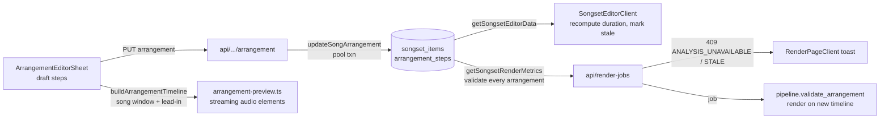

# Song Arrangement Editor — dev guide

Inventory of the source files behind the Song Arrangement Editor (issue #254, spec
`specs/song_arrangement_editor.md`), the analysis data a Recording needs before it can be arranged,
and the Recordings currently verified usable. Line counts were captured 2026-11-09 and drift as
files change — treat them as size hints only.

## What the feature is

A per-item arrangement is a reorder/repeat/omit of the analyzed sections of one Recording into
ordered Steps. It persists as JSON in `songset_items.arrangement_steps` (SQL NULL = use the
original full Recording), previews in the browser as a song-scoped window (this song plus an
adjustable lead-in from the preceding item), and renders on that new timeline in the render worker.
TypeScript and Python implement the same parse/validate/snap contract, pinned by a shared fixture.

## Analysis data prerequisites

A Songset item is arranges-able only when its Recording carries timed structure plus a beat grid.
Columns live on `recordings` (`delivery/webapp/src/db/schema.ts:97-99`):

| Column | Shape | Role |
|---|---|---|
| `sections` | JSON array of `{label, start, end}` (seconds) | one component block per section; `label` becomes the Step label |
| `beats` | JSON array of numbers (seconds) | snapping for every section bound; `downbeats` is stored but never read by the arrangement code |
| `duration_seconds` | number | clamping, snapping, arranged-duration math |
| `r2_lrc_url`, `lrc_status` | URL / status | per-Step lyric lines in the sheet |

`songs.sections` (`schema.ts:56`) is *structured lyrics* (labels + lines), not timings — the
arrangement code never reads it.

Availability rule, identical on both sides: `sections` non-empty AND `beats` non-empty AND
`duration_seconds > 0` AND `buildSnappedSteps(sections, beats, duration) !== null`
(`hasRecordingAnalysis`, `SongsetEditorClient.tsx:138-146`; `buildSnappedSteps`,
`lib/arrangements.ts:219-247`). Snapping rounds each bound to the nearest beat (ties to the earlier
beat) and returns `null` for the **whole Recording** as soon as one section's snapped `start` is no
longer `< end` (`arrangements.ts:242`; Python mirror `arrangements.py:210-211`). No per-section
skip, no UI repair path: one collapsed section disables Arrange for that Recording.

Sections are otherwise dropped individually, without failing the Recording, when the raw bounds are
outside `[0, duration_seconds]` (`arrangements.ts:233-234`) — e.g. the published fixture
`e2e348684622` stores a trailing `outro` of `232.42–244.78 s` against `duration_seconds = 244.77869`,
so that section is skipped and the sheet shows 9 Steps for 10 stored sections.

Data path to the sheet: `lib/db/songsets.ts:422-423` parses `sections`/`beats` into the item detail;
`updateSongArrangement` re-validates on PUT (`songsets.ts:1634-1641`) and
`getSongsetRenderMetrics` re-validates at render admission (`songsets.ts:1755-1760`).

## Webapp files

| File | Lines | Role |
|---|---|---|
| `delivery/webapp/src/lib/arrangements.ts` | 520 | Canonical vocabulary for every layer: types `RecordingSection`, `ArrangementStep`, `SongArrangement` (`version: 1`), `ArrangementItemInput`, `ArrangementTimeline`, `TimelineItemSource`; constants `MAX_ARRANGEMENT_STEPS = 64`, `VALIDATION_TOLERANCE_SECONDS = 1e-6` (staleness tolerance used by `validateSongArrangement`), `ARRANGEMENT_UNAVAILABLE_OR_STALE_MESSAGE`; `parseRecordingSections`/`parseRecordingBeats`, `buildSnappedSteps`, `parseSongArrangement`, `validateSongArrangement` (codes `ANALYSIS_UNAVAILABLE` / `ARRANGEMENT_INVALID` / `ARRANGEMENT_STALE`), `getItemDurationSeconds`, `calculateGapSeconds`, `getSongsetDurationSeconds`, `buildArrangementTimeline` |
| `delivery/webapp/src/lib/render/lrc-parser.ts` | 260 | LRC parsing (`parseLRC`, `isValidLRC`, `LRCLine`) plus `LYRIC_BOUNDARY_TOLERANCE_SECONDS = 0.5` and `linesForSourceRange`, which owns the lyric-to-Section assignment rule shared (by value) with the render worker. Taking the draft's Steps as `siblings`, a range accepts a 0.5 s pre-start pickup and hands its own final 0.5 s to the Step starting at its end, so lines tile: none shown twice, none dropped at the recording's ends |
| `delivery/webapp/src/lib/audio/arrangement-preview.ts` | 879 | Whole-Songset browser preview transport: streaming `<audio>` elements plus `AudioContext`, not `decodeAudioData` (25 min stereo ≈ 529 MB); `createArrangementPreviewSession`, `validateArrangementPreviewSources`; error kinds `no-recording` / `invalid-arrangement` / `playback-failed` |
| `delivery/webapp/src/hooks/useArrangementPreview.ts` | 418 | React binding: session created on first Play, torn down on stop/close; state keyed by serialized timeline inputs; `startAtSeconds` opens a song/section window on the full timeline (the caller enforces the window end); surfaces preview errors and the iOS silent-output crossfade fallback |
| `delivery/webapp/src/components/songset/ArrangementEditorSheet.tsx` | 1463 | The editor UI: lyrics-first component blocks (label, source time range, per-Step lyric lines, per-Step Play/Pause), drag reorder, duplicate/remove, in-sheet undo (button + Ctrl/Cmd+Z), song-scoped preview rail with a 0–30 s lead-in (default 10 s), and Reset/Save emitting exactly one PUT (no autosave). Per-Step lines come from `linesForSourceRange` in `lib/render/lrc-parser.ts`. Test ids: `arrangement-draft-step`, `arrangement-section-play-*`, `arrangement-undo`, `arrangement-lead-in`, `arrangement-lyric-line` |
| `delivery/webapp/src/components/songset/SongList.tsx` | 561 | Item-row surface: Arrange action (`onEditArrangement`) disabled when no saved arrangement and analysis unusable; Arranged badge; arranged duration (`data-testid="arranged-duration"`) or "Duration unavailable" (`arranged-invalid`) |
| `delivery/webapp/src/components/songset/SongsetEditor.tsx` | 684 | Editor shell: derives `hasUnknownDuration` from `arrangedDurationSeconds`, blocks Render with a destructive alert when any arrangement is invalid/stale, forwards `onEditArrangement` |
| `delivery/webapp/src/app/songsets/[id]/SongsetEditorClient.tsx` | 918 | Client state owner: `toArrangementInput`, `toSongListItem` (computes `arrangedDurationSeconds`, `arrangementAnalysisAvailable`), `handleSaveArrangement` (PUT → merge response detail → recompute Songset duration → mark stale), mounts the sheet |
| `delivery/webapp/src/app/songsets/[id]/page.tsx` | 71 | Server entry: `getSongsetEditorData` → serializes `arrangementSteps` and recording `sections`/`beats` per item |
| `delivery/webapp/src/app/api/songsets/[id]/items/[itemId]/arrangement/route.ts` | 114 | `PUT` save (`{ arrangement }`) or reset (`{ arrangement: null }`); zod `strictObject` with `version: 1` and 1–64 steps, label cap counted in code points to match the worker's `len()`; 401 / 400 `SONGSET_TOO_LONG` / 404 / 409 `ARRANGEMENT_ANALYSIS_UNAVAILABLE` \| `ARRANGEMENT_STALE` / 200 |
| `delivery/webapp/src/lib/db/songsets.ts` | 1807 | Persistence: `arrangementFieldsFromRaw` (NULL = full Recording, malformed JSON kept verbatim for diagnostics), item detail `{ arrangementSteps, arrangement, arrangementInvalid }`, `updateSongArrangement` (:1594), `analysisValidationError`, `getSongsetRenderMetrics` |
| `delivery/webapp/src/db/schema.ts` | 651 | `songset_items.arrangement_steps TEXT` (:220) |
| `delivery/webapp/src/db/mutation-db.ts` | 20 | Websocket `Pool` client for the two atomic mutations; `@/db` is `neon-http`, whose session rejects `transaction()` |
| `delivery/webapp/src/lib/i18n/messages/arrangement.ts` | 232 | `arrangement.*` namespace (sheet chrome, component blocks, lyrics states, section playback, lead-in, undo, errors, toasts), en + zh-Hant, compile-enforced completeness |
| `delivery/webapp/src/lib/i18n/messages/render.ts` | 273 | `render.error.arrangementRepairOrReset`, mirrors the canonical stale message |
| `delivery/webapp/src/app/api/render-jobs/route.ts` | 176 | Render admission: validates every saved arrangement, returns 409 with `ARRANGEMENT_UNAVAILABLE_OR_STALE_MESSAGE` and the validation code |
| `delivery/webapp/src/lib/render/job-manager.ts` | 424 | Selects arranged durations and runs the same validation via `getSongsetRenderMetrics` |
| `delivery/webapp/src/app/songsets/[id]/render/RenderPageClient.tsx` | 376 | Maps the 409 code to the translated repair-or-reset toast |
| `delivery/webapp/src/app/api/recordings/[hashPrefix]/audio/route.ts` | 110 | Same-origin audio proxy for the preview: R2 signed URLs are not CORS-enabled for Web Audio, so the server streams the body |

## Worker and cross-language contract

| File | Lines | Role |
|---|---|---|
| `delivery/render-worker/src/sow_render_worker/arrangements.py` | 332 | Python mirror of `lib/arrangements.ts`: `MAX_ARRANGEMENT_STEPS = 64`, same stale message, `RecordingSection`/`ArrangementStep`, `parse_recording_sections`/`parse_recording_beats`, `build_snapped_steps`, `parse_song_arrangement`, `validate_arrangement` |
| `delivery/render-worker/src/sow_render_worker/pipeline.py` | 618 | Re-validates every saved arrangement against current analysis before cutting audio (`validate_arrangement` at :206); passes `arrangement_steps` into the engine |
| `delivery/render-worker/src/sow_render_worker/audio_engine.py` | 498 | Cuts selected audio per step from `arrangement_steps` (:273, :361) |
| `delivery/render-worker/src/sow_render_worker/lrc_parser.py` | 206 | Lyrics are remapped per clip in arrangement order; `remap_lrc_to_clips` applies the same `LYRIC_BOUNDARY_TOLERANCE_SECONDS = 0.5` tiling rule as the webapp (a clip accepts a pre-start pickup and hands over its tail only to a clip that actually starts at its end) and clamps a pre-start line to the clip's target start, so sheet and video agree and the unarranged full-file clip keeps its final lines |
| `delivery/webapp/src/test/fixtures/arrangements.cross_language.json` | 90 | Shared numeric fixture: both suites assert identical snapped steps |

The fixture is asserted at **≤ 1e-9** in both suites
(`delivery/webapp/src/test/lib/arrangements.test.ts:49-50`,
`delivery/render-worker/tests/test_arrangements.py:69-70`). `VALIDATION_TOLERANCE_SECONDS = 1e-6`
is a different constant — the tolerance `validateSongArrangement` uses for staleness — and is not
the fixture bound.

## Flow



## Recordings with usable arrangement data

Verified 2026-11-10 against the configured Neon database (`SOW_DATABASE_URL`, sourced from
`/opt/sow/.env`) with the app's own parse/snap/validate functions. Read-only snapshot: nothing here
implies a database change.

### Arrangeable, `visibility_status = 'review'`

Ten Recordings chosen for a spread of section counts and label vocabularies; all have
`lrc_status = 'completed'`, audio + LRC objects in R2, and live in two Songsets each. The in-app
browse API defaults to `published,review` (`api/songs/route.ts:85-90`), so `review` Recordings are
addable to a Songset and arrangeable today.

| # | `hash_prefix` | Title | `songs.id` | Duration | Sections → Steps | Label sequence | Arranged duration | Songsets |
|---|---|---|---|---|---|---|---|---|
| 1 | `3c0772a6c961` | 最珍貴的角落 | `zui_zhen_gui_de_jiao_luo_e1cf618a` | 252.83 s | 2 → 2 | verse 1, chorus | 93.94 s | Hope_Grace_Set_12, Hope_Grace_Set_2 |
| 2 | `446ee6cc4768` | 甦醒 | `su_xing_cb0e9895` | 219.52 s | 2 → 2 | chorus, verse | 80.07 s | Hope_Grace_Set_20, Hope_Grace_Set_9 |
| 3 | `8720ed26892f` | 全然向祢 | `quan_ran_xiang_mi_79bb05cb` | 283.52 s | 3 → 3 | verse, chorus, chorus | 124.26 s | Hardship_Grace_1, Hardship_Grace_3 |
| 4 | `31676c05b3c1` | 是耶穌 | `shi_ye_su_f8d7c4a7` | 272.02 s | 3 → 3 | verse, verse, chorus | 111.70 s | Hope_Grace_Set_10, Hope_Grace_Set_20 |
| 5 | `138f339e3dce` | 展開清晨的翅膀 | `zhan_kai_qing_chen_de_chi_bang_44a8f2f4` | 322.92 s | 4 → 4 | chorus ×4 | 135.27 s | Hope_Grace_Set_8, Test Arrangement |
| 6 | `9e2eb249c3de` | 我選擇喜樂 | `wo_xuan_ze_xi_le_e2ec9095` | 177.15 s | 5 → 5 | verse, chorus 1, verse, chorus 1, chorus 2 | 146.90 s | Set15_信心復興, 絕望與恩典_藏身恩典 |
| 7 | `a7a5745b439e` | 誰能像祢 | `shui_neng_xiang_mi_70ade820` | 201.39 s | 5 → 5 | verse, chorus, verse, chorus, coda | 140.05 s | Hardship_Grace_3, Hardship_Grace_5 |
| 8 | `1c172aa74bfe` | 主的喜樂是我力量 | `zhu_de_xi_le_shi_wo_li_liang_e1084c5e` | 256.27 s | 6 → 6 | verse, verse, chorus, verse, chorus, chorus | 205.98 s | Hope_Grace_Set_19, Hope_Grace_Set_9 |
| 9 | `751e0e5286bc` | 聖潔的羔羊 | `sheng_jie_de_gao_yang_6c8e17b1` | 489.02 s | 7 → 7 | verse, verse, chorus, verse, chorus, chorus, chorus | 426.66 s | 絕望與恩典_羔羊恩典, 齊來讚美_我敬拜祢_聖潔的羔羊_主啊，我要跟隨祢 |
| 10 | `210344eabd33` | 十字架 | `shi_zi_jia_a5203e7d` | 351.57 s | 8 → 8 | verse, chorus, verse, chorus, refrain, refrain, chorus, chorus | 298.18 s | Set03_信心, Set05_十字架 |

### Arrangeable, `visibility_status = 'published'`

Exactly one published Recording passes the availability rule. It is the E2E fixture, appears in two
test Songsets, and is the only published item that can be arranged without publishing more
Recordings:

| # | `hash_prefix` | Title | `songs.id` | Duration | Sections → Steps | Label sequence | Arranged duration | Songsets |
|---|---|---|---|---|---|---|---|---|
| 1 | `e2e348684622` | Arrangement E2E Song | `arrangement_e2e_849348684622` | 244.78 s | 10 → 9 | intro, verse, verse, inst, intro, verse, verse, chorus, chorus | 226.20 s | Arrangement E2E 1794151675566, Arrangement Render 1794152024896 |

Of the 106 published Recordings, only 3 carry `sections` + `beats`; the other 103 have no analysis
data at all, and the two non-fixture ones fail snapping (see *Known analysis-data gaps*). Making
more published Recordings arrangeable is a single job: give them the missing analysis with the
backfill recipe in *Finding and backfilling arrangeable recordings*, passing `--include-published`
so the published rows are written in place. No demote/re-publish cycle is needed — the flag never
changes `visibility_status`. This guide performs neither.

Arranged duration is `getItemDurationSeconds` for all snapped Steps in section order (sum of Step
lengths), which is why it is shorter than the Recording: untaken gaps and untaken repeats are
dropped (e.g. 是耶穌 `31676c05b3c1` spans 30.62–234.02 s but arranges to 111.70 s).

Reproduce the counts (no `psql` on this host; the `postgres` package ships with the webapp):

```bash
set -a; . /opt/sow/.env; set +a   # provides SOW_DATABASE_URL
cd delivery/webapp && npx tsx -e '
import postgres from "postgres";
import { parseRecordingSections, parseRecordingBeats, buildSnappedSteps } from "./src/lib/arrangements.ts";
const sql = postgres(process.env.SOW_DATABASE_URL!, { ssl: "require", max: 1 });
(async () => {
  const rows = await sql.unsafe("select r.hash_prefix, r.duration_seconds, r.sections, r.beats from recordings r where r.deleted_at is null and r.sections is not null and r.beats is not null");
  let usable = 0;
  for (const row of rows) {
    const steps = buildSnappedSteps(parseRecordingSections(row.sections), parseRecordingBeats(row.beats), row.duration_seconds);
    if (steps) usable += 1;
  }
  console.log(rows.length, usable);
  await sql.end();
})().catch((e) => { console.error(e); process.exit(1); });
'
```

Expected output: `322 320`. No `songset_items.arrangement_steps` row is non-NULL yet.

## Known analysis-data gaps

Two of the 322 analyzed Recordings fail the availability rule; both are `visibility_status =
'published'` and used by real Songsets, so Arrange is disabled on those items:

| `hash_prefix` | Title | Songset items | First section | First detected beat | Effect |
|---|---|---|---|---|---|
| `28a0ed6e1408` | 與祢漫步 | 8 (incl. Hope_Grace_Set_6, Set03_信心, Agent Proposal #1) | `start` 0.00–0.17 s | 6.23 s | both bounds snap to 6.23 s → collapsed → `buildSnappedSteps` returns `null` |
| `e5c16c2f35f2` | 從早晨到夜晚 | 2 (Arrangement E2E 1794151675566) | `start` 0.00–0.21 s | 8.44 s | both bounds snap to 8.44 s → same collapse |

The degenerate leading `start` micro-section (analysis artefact emitted before the first detected
beat) is the sole collapse: every other section of both Recordings either snaps to a non-zero
length or is skipped as out-of-range. Because `buildSnappedSteps` bails out on the first collapse,
the failure is all-or-nothing for the Recording. Both also carry the same harmless quirk as the
published fixture — a trailing `outro` whose `end` runs 1.31 ms and 1.35 ms past `duration_seconds`
respectively — but out-of-range sections are *skipped* per `arrangements.ts:233-234`, not fatal.
Clearing the collapse means regenerating `recordings.sections`: `sow-admin audio write-structure`
rederives both columns from the lyric timeline plus the cached beat grid and drops any section that
would still collapse, so the repair is `beat-grid` + `write-structure` with `--include-published`
(see *Finding and backfilling arrangeable recordings*). Neither the webapp nor the admin CLI exposes
a manual section-timing editor; the admin component editor only edits lyrics.

## Finding and backfilling arrangeable recordings

A Recording is arrangeable only when all four conditions hold:

1. `duration_seconds` is present and > 0;
2. `recordings.sections` parses as a JSON array of `{label, start, end}` (non-empty `str` label,
   finite numeric bounds);
3. `recordings.beats` parses as a non-empty array of finite numbers, at least one inside
   `[0, duration_seconds]`;
4. `buildSnappedSteps` (`arrangements.ts:219-259`) returns steps for the whole Recording.

Condition 4 is all-or-nothing: if **any** section collapses to zero length after snapping, the
whole Recording is unarrangeable even when every other section snaps cleanly (that is exactly the
two published failures in *Known analysis-data gaps*). So storing the two columns is necessary but
not sufficient, and a presence-only audit over-reports coverage.

The admin CLI mirrors the rule in
`ops/admin-cli/src/stream_of_worship/admin/services/arrangement_structure.py`
(`evaluate_recording_structure`); it is pinned to the webapp and render-worker implementations by
the shared fixture `delivery/webapp/src/test/fixtures/arrangements.cross_language.json` (all three
suites assert the same snapped bounds to 1e-9). Use it to classify the library:

| `audio list --structure` | SQL predicate | Arrange editor opens? |
|---|---|---|
| `missing` | `sections` or `beats` NULL / `''` / `'[]'` | no |
| `present` | both columns non-empty (presence test only) | **maybe** — snapping may still fail |
| `unusable` | `present` **and** the snap-aware gate fails | no |

`missing` ∪ `unusable` is exactly the set of Recordings that cannot open Arrange; `present` −
`unusable` is the arrangeable set. `--structure unusable` is evaluated in the CLI after the SQL
prefilter, so its `--limit` is applied **after** the gate check (a SQL `LIMIT` would drop rows that
look present but are unusable).

`sow-admin audio structure-audit` prints one verdict per Recording. It is read-only — no writes, no
analysis jobs — and exits 0 unless config/DB loading fails. Only non-arrangeable rows are emitted
(the arrangeable count appears in the summary), so `--format ids` is the pipeline input for the
repair commands, while `--format json` carries the same rows as objects (`verdict`, `detail`,
`steps`, and the offending `section`). Excerpt of a real run, table borders trimmed:

```console
$ sow-admin audio structure-audit --limit 2
Non-arrangeable recordings (2)
┃ Album              ┃ Title            ┃ Vis ┃ Verdict          ┃ Detail                              ┃ Song ID                           ┃ Hash Prefix  ┃
│ After All These Y… │ Here I Bow       │  ●  │ missing_sections │ recordings.sections absent or empty │ hereibow_a9271bf4                 │ 6a410a5c222a │
│ G.L.O.W. 差遣我    │ 主啊，我要跟隨祢 │  ●  │ missing_sections │ recordings.sections absent or empty │ zhu_a__wo_yao_gen_sui_mi_83163301 │ dbd506660aa3 │
Summary: 320 arrangeable, 127 non-arrangeable (447 recordings)
collapsed=2, missing_sections=125
Among non-arrangeable: 105 published — pass --include-published to the repair commands to backfill them in place (no demotion; rewriting sections/beats can make a saved arrangement stale)
Repair: sow-admin audio structure-audit --format ids | sow-admin audio beat-grid --include-published --stdin  then  sow-admin audio structure-audit --format ids | sow-admin audio write-structure --include-published --stdin
```

Verdicts, in precedence order (first match wins):

| Verdict | Trigger |
|---|---|
| `no_duration` | `duration_seconds` NULL or ≤ 0 |
| `missing_sections` | `sections` NULL/blank/`[]` |
| `invalid_sections` | `sections` non-blank but unparseable / not an array of `{label,start,end}` |
| `missing_beats` | `beats` NULL/blank/unparseable, or no finite *number* entries (madmom `[time, position]` pairs do not count — `parseRecordingBeats` drops them too) |
| `no_beats_in_range` | beats parse, but none inside `[0, duration_seconds]` |
| `collapsed` | one section's snapped `start`/`end` become equal → whole Recording unarrangeable; `section` names the offender |
| `no_usable_sections` | every section is out of range or has `start >= end` |
| `arrangeable` | `buildSnappedSteps` returns steps |

Live counts on the configured Neon DB: 447 active Recordings, 320 `arrangeable`, 127
non-arrangeable (125 `missing_sections`, 2 `collapsed`), of which 105 are published. `present` = 322
matches the *322 analyzed* figure in *Recordings with usable arrangement data*; the 125
`missing_sections` rows are the never-analyzed or no-retained-analysis columns. The 127 is not a
repair quota — 105 are published and need `--include-published` to be repaired, and the LRC ceiling
below means some can never gain sections.

### Who produces what

The Analysis Service supplies the inputs; the admin CLI decides and writes.

- `sow-admin audio beat-grid` submits a `beat_grid` job
  (`BeatGridJobRequest`, `ops/analysis-service/src/sow_analysis/models.py:247`): madmom runs on the
  `sow-downbeats` Modal app and the grid is cached to `{hash_prefix}/beat_grid.json` in R2. No
  components, no LLM.
- `sow-admin audio analyze --analysis-tier full` persists allin1 `sections` + `beats` from the job
  result (the fast tier writes neither) and sets `analysis_status = 'completed'`.
- `sow-admin audio write-structure` runs **entirely locally, with no job**: it reads
  `{hash_prefix}/beat_grid.json` + `{hash_prefix}/lyrics.lrc` from R2, calls
  `derive_sections_from_lyrics`, passes the result through `_finalize_arrangement_structure` (which
  snaps every bound to the nearest beat and drops collapsing/out-of-range sections), and writes
  `sections`/`beats` via `update_recording_structure`. `analysis_status` is left untouched — it
  still means "the full allin1 tier ran", and `Recording.has_full_analysis` remains the marker for
  authoritative allin1 sections.
  `derive_sections_from_lyrics` treats the LRC as the ground truth for **order and timing** and
  `structured_lyrics` only as a **label source**: each timed LRC line is labelled by whichever
  section explains most of its text, and consecutive same-label lines form one occurrence. That is
  why a `[verse]` block whose lines are sung on either side of a chorus still yields both verse
  occurrences plus the chorus, and why LRC lines that pack two lyric lines into one timestamp still
  match.
- `sow-admin audio structure-audit` and `audio list --structure …` only read the row and apply the
  webapp rule; they never repair.

### Repair recipe

Scope the repair set first, and keep it: rewriting `sections`/`beats` under a saved arrangement makes
that arrangement stale, so a run should touch exactly the Recordings you intend to fix. Published
rows are included with `--include-published` and stay published — no demote/re-publish cycle.

```bash
set -a; . /opt/sow/.env; set +a   # SOW_ANALYSIS_API_KEY + R2 credentials

# 0. Pick the repair set and keep it. `structure-audit --format ids` is every row
#    the gate rejects (missing ∪ unusable); narrow it to what this run can fix:
sow-admin audio list --structure unusable --format ids > /tmp/repair.txt   # snap failures only
#    or: sow-admin audio structure-audit --album <name> --format ids > /tmp/repair.txt

# 1. Materialise missing beat grids (idempotent: existing grids are skipped)
sow-admin audio beat-grid --stdin --include-published < /tmp/repair.txt

# 2. Rewrite sections+beats locally (~1s/song, no job)
sow-admin audio write-structure --stdin --include-published < /tmp/repair.txt

# 3. Residual, by verdict — the rows that need a different fix (or none exists)
sow-admin audio structure-audit --visibility published   # plus the review/hold pools
```

`--include-published` is a deliberate per-run override of the publish guard: it writes the two
arrangement columns in place and never writes `visibility_status`. Both steps report a per-row
`published recording — proceeding (--include-published)` line and count the rows in the summary
(`..., N published`), so the override is visible in the run log rather than implicit.

`audio components <song_id...> --write-recording-analysis` is the per-song alternative to steps 1–2
when a component analysis run is already warranted; it derives the same columns from the same two
artifacts (see `ops/admin-cli/README.md:447-624` — *Making songs arrangeable* for that path and
*Beat-grid backfill for unarrangeable recordings* for the beat-grid path, which also documents the
`sow-downbeats` Modal queue timing and the `SOW_MODAL_DOWNBEATS_MAX_AUDIO_BYTES` audio-size cap).

Caveats:

- **Published rows are written in place only with `--include-published`**; without it `beat-grid`
  and `write-structure` report them as `skipped_published`, so the collapsed published Recordings
  need the flag. There is no demote/re-publish cycle: the flag never touches
  `visibility_status`.
- **`ARRANGEMENT_STALE`**: regenerating a Recording that already has saved
  `songset_items.arrangement_steps` changes the section indices/labels underneath them, so
  `validateSongArrangement` reports `ARRANGEMENT_STALE` and Render is blocked until the arrangement
  is recreated. Check `songset_items` before rewriting a Recording used by real Songsets.
- **Unfixable class**: a Recording whose LRC stops before the lyrics do cannot gain sections
  (measured ceiling: 418 of 446 visible Recordings derive at least one section; median uncovered
  tail 33 s). `write-structure` reports those as `no_structure` and they stay unarrangeable by
  design.

## Tests

- Webapp (all under `delivery/webapp/src/`): `test/lib/arrangements.test.ts`,
  `test/lib/audio/arrangement-preview.test.ts`, `test/hooks/useArrangementPreview.test.tsx`,
  `test/components/songset/{ArrangementEditorSheet,SongList,SongList.favorites,SongsetEditor,SongsetEditorClient}.test.tsx`,
  `test/api/songsets/{arrangement,arrangement-persistence,db}.test.ts`,
  `test/api/render-jobs/route.test.ts`, `test/lib/render/job-manager.test.ts`,
  `test/accessibility/accessibility.test.tsx`.
- Worker: `delivery/render-worker/tests/test_arrangements.py`, plus the arrangement-aware cases in
  `test_audio_engine.py`, `test_pipeline.py`, `test_video_engine.py`.

## Invariants

- A stored-but-invalid arrangement yields `arrangedDurationSeconds === null` and MUST NOT fall back
  to the original Recording duration; Render is blocked and the user must repair analysis or reset
  the arrangement.
- SQL NULL means "original full Recording". Malformed JSON is kept verbatim (never dropped) so it
  can be repaired, reset, or duplicated.
- 409 codes are `ARRANGEMENT_ANALYSIS_UNAVAILABLE` and `ARRANGEMENT_STALE`; the stale message string
  is byte-identical in TS and Python.
- 1–64 steps per item (`MAX_ARRANGEMENT_STEPS`), labels capped in code points on both sides.
