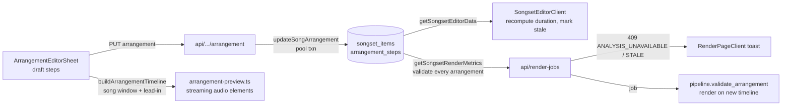

# Song Arrangement Editor — file map

Inventory of the source files behind the Song Arrangement Editor (issue #254, spec
`specs/song_arrangement_editor.md`). Line counts were captured 2026-11-09 and drift as files
change — treat them as size hints only.

## What the feature is

A per-item arrangement is a reorder/repeat/omit of the analyzed sections of one Recording into
ordered Steps. It persists as JSON in `songset_items.arrangement_steps` (SQL NULL = use the
original full Recording), previews in the browser as a song-scoped window (this song plus an
adjustable lead-in from the preceding item), and renders on that new timeline in the render worker.
TypeScript and Python implement the same parse/validate/snap contract, pinned by a shared fixture.

## Webapp files

| File | Lines | Role |
|---|---|---|
| `delivery/webapp/src/lib/arrangements.ts` | 520 | Canonical vocabulary for every layer: types `RecordingSection`, `ArrangementStep`, `SongArrangement` (`version: 1`), `ArrangementItemInput`, `ArrangementTimeline`, `TimelineItemSource`; constants `MAX_ARRANGEMENT_STEPS = 64`, `VALIDATION_TOLERANCE_SECONDS = 1e-6` (staleness tolerance used by `validateSongArrangement`), `ARRANGEMENT_UNAVAILABLE_OR_STALE_MESSAGE`; `parseRecordingSections`/`parseRecordingBeats`, `buildSnappedSteps`, `parseSongArrangement`, `validateSongArrangement` (codes `ANALYSIS_UNAVAILABLE` / `ARRANGEMENT_INVALID` / `ARRANGEMENT_STALE`), `getItemDurationSeconds`, `calculateGapSeconds`, `getSongsetDurationSeconds`, `buildArrangementTimeline` |
| `delivery/webapp/src/lib/audio/arrangement-preview.ts` | 879 | Whole-Songset browser preview transport: streaming `<audio>` elements plus `AudioContext`, not `decodeAudioData` (25 min stereo ≈ 529 MB); `createArrangementPreviewSession`, `validateArrangementPreviewSources`; error kinds `no-recording` / `invalid-arrangement` / `playback-failed` |
| `delivery/webapp/src/hooks/useArrangementPreview.ts` | 418 | React binding: session created on first Play, torn down on stop/close; state keyed by serialized timeline inputs; `startAtSeconds` opens a song/section window on the full timeline (the caller enforces the window end); surfaces preview errors and the iOS silent-output crossfade fallback |
| `delivery/webapp/src/components/songset/ArrangementEditorSheet.tsx` | 1391 | The editor UI: lyrics-first component blocks (label, source time range, per-Step lyric lines from LRC, per-Step Play/Pause), drag reorder, duplicate/remove, in-sheet undo (button + Ctrl/Cmd+Z), song-scoped preview rail with a 0–30 s lead-in (default 10 s), and Reset/Save emitting exactly one PUT (no autosave). Test ids: `arrangement-draft-step`, `arrangement-section-play-*`, `arrangement-undo`, `arrangement-lead-in` |
| `delivery/webapp/src/components/songset/SongList.tsx` | 561 | Item-row surface: Arrange action (`onEditArrangement`) disabled when no saved arrangement and analysis unusable; Arranged badge; arranged duration (`data-testid="arranged-duration"`) or "Duration unavailable" (`arranged-invalid`) |
| `delivery/webapp/src/components/songset/SongsetEditor.tsx` | 684 | Editor shell: derives `hasUnknownDuration` from `arrangedDurationSeconds`, blocks Render with a destructive alert when any arrangement is invalid/stale, forwards `onEditArrangement` |
| `delivery/webapp/src/app/songsets/[id]/SongsetEditorClient.tsx` | 918 | Client state owner: `toArrangementInput`, `toSongListItem` (computes `arrangedDurationSeconds`, `arrangementAnalysisAvailable`), `handleSaveArrangement` (PUT → merge response detail → recompute Songset duration → mark stale), mounts the sheet |
| `delivery/webapp/src/app/songsets/[id]/page.tsx` | 71 | Server entry: `getSongsetEditorData` → serializes `arrangementSteps` and recording `sections`/`beats` per item |
| `delivery/webapp/src/app/api/songsets/[id]/items/[itemId]/arrangement/route.ts` | 114 | `PUT` save (`{ arrangement }`) or reset (`{ arrangement: null }`); zod `strictObject` with `version: 1` and 1–64 steps, label cap counted in code points to match the worker's `len()`; 401 / 400 `SONGSET_TOO_LONG` / 404 / 409 `ARRANGEMENT_ANALYSIS_UNAVAILABLE` \| `ARRANGEMENT_STALE` / 200 |
| `delivery/webapp/src/lib/db/songsets.ts` | 1807 | Persistence: `arrangementFieldsFromRaw` (NULL = full Recording, malformed JSON kept verbatim for diagnostics), item detail `{ arrangementSteps, arrangement, arrangementInvalid }`, `updateSongArrangement` (:1594), `analysisValidationError`, `getSongsetRenderMetrics` |
| `delivery/webapp/src/db/schema.ts` | 651 | `songset_items.arrangement_steps TEXT` (:220) |
| `delivery/webapp/src/db/mutation-db.ts` | 20 | Websocket `Pool` client for the two atomic mutations; `@/db` is `neon-http`, whose session rejects `transaction()` |
| `delivery/webapp/src/lib/i18n/messages/arrangement.ts` | 232 | `arrangement.*` namespace (sheet chrome, component blocks, lyrics states, section playback, lead-in, undo, errors, toasts), en + zh-Hant, compile-enforced completeness |
| `delivery/webapp/src/lib/i18n/messages/render.ts` | 273 | `render.error.arrangementRepairOrReset`, mirrors the canonical stale message |
| `delivery/webapp/src/app/api/render-jobs/route.ts` | 176 | Render admission: validates every saved arrangement, returns 409 with `ARRANGEMENT_UNAVAILABLE_OR_STALE_MESSAGE` and the validation code |
| `delivery/webapp/src/lib/render/job-manager.ts` | 424 | Selects arranged durations and runs the same validation via `getSongsetRenderMetrics` |
| `delivery/webapp/src/app/songsets/[id]/render/RenderPageClient.tsx` | 376 | Maps the 409 code to the translated repair-or-reset toast |
| `delivery/webapp/src/app/api/recordings/[hashPrefix]/audio/route.ts` | 110 | Same-origin audio proxy for the preview: R2 signed URLs are not CORS-enabled for Web Audio, so the server streams the body |

## Worker and cross-language contract

| File | Lines | Role |
|---|---|---|
| `delivery/render-worker/src/sow_render_worker/arrangements.py` | 332 | Python mirror of `lib/arrangements.ts`: `MAX_ARRANGEMENT_STEPS = 64`, same stale message, `RecordingSection`/`ArrangementStep`, `parse_recording_sections`/`parse_recording_beats`, `build_snapped_steps`, `parse_song_arrangement`, `validate_arrangement` |
| `delivery/render-worker/src/sow_render_worker/pipeline.py` | 618 | Re-validates every saved arrangement against current analysis before cutting audio (`validate_arrangement` at :206); passes `arrangement_steps` into the engine |
| `delivery/render-worker/src/sow_render_worker/audio_engine.py` | 498 | Cuts selected audio per step from `arrangement_steps` (:273, :361) |
| `delivery/render-worker/src/sow_render_worker/lrc_parser.py` | 159 | Lyrics clips are processed in arrangement order |
| `delivery/webapp/src/test/fixtures/arrangements.cross_language.json` | 90 | Shared numeric fixture: both suites assert identical snapped steps |

The fixture is asserted at **≤ 1e-9** in both suites
(`delivery/webapp/src/test/lib/arrangements.test.ts:49-50`,
`delivery/render-worker/tests/test_arrangements.py:69-70`). `VALIDATION_TOLERANCE_SECONDS = 1e-6`
is a different constant — the tolerance `validateSongArrangement` uses for staleness — and is not
the fixture bound.

## Flow

## Tests

- Webapp (all under `delivery/webapp/src/`): `test/lib/arrangements.test.ts`,
  `test/lib/audio/arrangement-preview.test.ts`, `test/hooks/useArrangementPreview.test.tsx`,
  `test/components/songset/{ArrangementEditorSheet,SongList,SongList.favorites,SongsetEditor,SongsetEditorClient}.test.tsx`,
  `test/api/songsets/{arrangement,arrangement-persistence,db}.test.ts`,
  `test/api/render-jobs/route.test.ts`, `test/lib/render/job-manager.test.ts`,
  `test/accessibility/accessibility.test.tsx`.
- Worker: `delivery/render-worker/tests/test_arrangements.py`, plus the arrangement-aware cases in
  `test_audio_engine.py`, `test_pipeline.py`, `test_video_engine.py`.

## Invariants

- A stored-but-invalid arrangement yields `arrangedDurationSeconds === null` and MUST NOT fall back
  to the original Recording duration; Render is blocked and the user must repair analysis or reset
  the arrangement.
- SQL NULL means "original full Recording". Malformed JSON is kept verbatim (never dropped) so it
  can be repaired, reset, or duplicated.
- 409 codes are `ARRANGEMENT_ANALYSIS_UNAVAILABLE` and `ARRANGEMENT_STALE`; the stale message string
  is byte-identical in TS and Python.
- 1–64 steps per item (`MAX_ARRANGEMENT_STEPS`), labels capped in code points on both sides.
