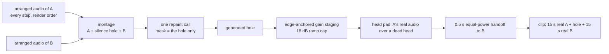

# Audio-inpaint POC — implementation summary

Branch `audio_imprint_poc` (name kept from the earlier imprint prototype), pushed to
`origin`. Commits: `e194d849` (implementation), `25f7a973` (run record + GPU accounting),
`a4ffb2d1` (review page), `4242a56e` (review-page caveat).

Goal: make a seam between two songs sound continuous by generating only the music that is
missing, while every second of real recording stays sample-identical in the output. Two
variations share one script: `--mode bridge` (an 8 s or 16 s replacement bridge) and
`--mode gap` (the production 2-beat gap, 1.393 s), each runnable on ACE-Step 1.5 base,
ACE-Step turbo, or Stable Audio 3 (`--engine`).

## 1. The defect this replaces

`run1` generated the bridge as two independent half-holes and butted them together:

| defect | evidence from `run1`/`run2` |
|---|---|
| two generations, two keys | requests: left `D Major`, right `C Major`, split at 12 s (8 s hole) / 20 s (16 s hole) |
| pass 1's right context was digital silence | pass 1 repainted `[8, 8+N/2)` while `[8+N/2, 8+N)` was still zeros — no music was ever heard on the incoming side |
| tempo/key from `song_components`, not recordings | rows said 84.72/86.13 BPM for A, whose recording is 68 BPM / D major |
| no reference audio | the client called `repaint(bytes, name, request)`; the app has a 4th parameter |
| the clip played the model's roundtrip | `assemble` concatenated `head + model body + tail` |
| result | best chroma correlation against real context 0.12–0.16, 16 s takes L/R 0.00–0.23, 1.3 kHz → 3.6 kHz step into B |

## 2. How the pipeline works now



- **Montage** = `arranged_audio()` of each side (all arrangement steps in playback order),
  capped by `--context-seconds` (default 15 s per side; `0` = whole arrangement), plus a
  hole of digital silence where the seam is. In gap mode the hole is exactly two beats at
  the incoming recording's tempo (1.393 s = 61,431 frames at 86.13281 BPM).
- **One request per take**, mask over the whole hole: ACE-Step gets
  `repaint_start/repaint_end`, `duration`, recording-sourced `bpm`/`keyscale`, 64 steps +
  ADG + conservative repaint, and a 30 s / 48 kHz style reference built from both arranged
  sides. SA3 gets exactly its six keys (`prompt`, `seed`, `steps`, `start_seconds`,
  `end_seconds`, `duration_seconds`) and no reference.
- **Assembly never splices model audio into the context**: the clip's two 15 s sides are
  the recordings themselves (asserted sample-for-sample in tests), the model contributes
  only the hole.
- **Level continuity is anchored on the joints**, not on means: each end of the hole is
  gain-ramped to the 200 ms of real audio beside it, capped at
  `EDGE_GAIN_LIMIT_DB = 18.0`; the residual is recorded as `staged_edge_error_db`.
- **A dead head is covered with real audio**: `Seam.a_post` carries A's own audio from the
  seam up to `HEAD_PAD_MAX_SECONDS = 3.0`; `assemble` splices it over the hole's measured
  dead head (+0.15 s margin, 0.25 s crossfade), reported as `hole_head_pad_seconds`.
- **The tail is handed to B**: a 0.5 s equal-power crossfade from the hole into B's real
  opening (`hole_overlap_seconds`), measured before and after as `raw_join_rms_jump_db`
  vs `join_rms_jump_db`.
- **Refusals instead of silent defects**: a hole that is non-finite, peaks below 0.001, or
  sits below `SILENCE_RMS_FLOOR_DB = -50.0` is refused; a hole that cannot be staged
  within `MAX_JOIN_RESIDUAL_DB = 6.0` after the 18 dB ramp is refused; in gap mode a fill
  with more than `MAX_GAP_TRAILING_SILENCE_MS = 50.0` of dead air before the incoming
  downbeat is refused. Every refusal is written as `status: "failed"` with the measured
  numbers, so the listening page shows the failure rather than a dropout.
- **Gap timing corrections** (copied from `gen_seam_fill_run3.py`): `raw` (model output),
  `trim` (drop the lead-in, pad the end), `grid` (also time-stretch so hit two lands one
  incoming beat after hit one). `detect_onsets` dedupes hits closer than 60 ms, because
  librosa split one attack into 23.22 ms and 46.44 ms and reported a −650 ms beat-two
  error on a fill whose accent was on the beat.

## 3. Files

| file | change | lines |
|---|---|---|
| `lab/poc-scripts/gen_audio_inpaint.py` | rewritten around the single-seam model: `Seam` (`a_arranged`/`b_arranged`/`a_post`), `build_montage`, `build_reference`, `build_request`, `call_engine`, `run_take`, `run_gap_take`, `assemble`, `correct_gap_timing`, `timing_metrics`, `report_html`, `main`; CLI `--mode`, `--engine`, `--align`, `--takes`, `--steps`, `--context-seconds`, `--lengths`, `--arcs`, `--treatments`, `--skip-intra`, `--dry-run`, `--force`, `--refresh-captions`, `--no-reference` | 1,479 → 2,974 |
| `lab/poc-scripts/modal_apps/sa3_inpaint_app.py` | `MODEL_VARIANTS` + `SOW_SA3_MODEL` (default `medium`), `MAX_SECONDS = 380.0` refusal instead of a short return, `sample_size` from the request duration, flash-attn gate, CPU fallback removed | 451 |
| `lab/poc-scripts/tests/test_gen_audio_inpaint.py` | new: 21 synthetic-audio tests (arrangement, reference ordering, request shape, assembly, gap timing, every refusal path) | 678 |
| `lab/poc-scripts/build_review_index.py` | new: writes the cross-run review page from each run's `index.json` | 300 |
| `lab/poc-scripts/AUDIO_INPAINT_RUNS.md` | new: the run record (what each run is, reproduce commands, measured tables, metric definitions) | 112 |
| `lab/poc-scripts/pyproject.toml` | `scipy>=1.10.0` in the `audio_inpaint` extra (48 kHz reference resampling via `resample_poly`) | +1 |

`gen_seam_fill.py` and `gen_seam_fill_run3.py` are untouched and still pass their tests.

## 4. Measured results

Runs live in `lab/poc-scripts/output/audio-inpaint/` (git-ignored, local artifacts).

| run | mode | engine | records (ok) | wall | GPU (per-call) |
|---|---|---|---|---|---|
| `run5-arranged` | bridge | `acestep-v15-base` | 45 (45) | 801 s | 378 s |
| `run5-arranged-sa3` | bridge | `sa3-medium` | 45 (45) | 376 s | 42 s |
| `run5-gap` | gap | `acestep-v15-base` | 18 (13) | 117 s | 45 s |
| `run5-gap-sa3` | gap | `sa3-medium` | 14 (2) | 99 s | 6 s |

Bridges (boundary 8 s and 16 s holes at 15 s context; intra 8 s holes at 8 s):

| measured | ACE-Step base | SA3 medium |
|---|---|---|
| join RMS step, left | 2.22 dB (0.64–3.74) | 2.27 dB (1.90–4.95) |
| join RMS step, right, after the handoff | −3.84 dB | −3.99 dB |
| raw right splice, before the handoff | 0.43 dB mean, max 6.89 | 4.87 dB mean, max 16.17 |
| chroma vs real A / B | 0.37 / 0.40 | 0.65 / 0.45 |
| stereo L/R coherence | 0.84 (0.50–0.99) | 0.60 (0.01–0.84) |
| A's audio borrowed for the head | 0.17 s mean | 0.75 s (0.15–2.40) |
| GPU per take | 8.41 s | 0.93 s |

Gap (1.393 s production gap):

| | ok / refused | beat-two peak error | trailing dead air |
|---|---|---|---|
| base `raw` | 6 / 0 | −26.8 … +44.1 ms | 0–0.02 ms |
| base `trim` | 5 / 1 | −45.7 … +44.2 ms | 23–46 ms |
| base `grid` | 2 / 4 | +13.4, +36.4 ms | 0.02 ms (ok); 68–90 ms (refused) |
| SA3, all corrections | 2 / 12 | +16.6, +39.8 ms | 0–0.02 ms (ok); 58 ms (refused) |

Verdict: ACE-Step base fills the gap; SA3 medium does not (2 fills came back at −66 dB RMS
silence, 9 could not be staged with a 17–42 dB residual after the 18 dB ramp, 1 left 58 ms
of dead air). On bridges SA3 agrees with A's harmony far better (0.65 vs 0.37) and is 9×
faster, while base has the more coherent stereo image and better-behaved raw tail.

For a gap the right join is expected to be positive (the fill's last hit decays into B's
downbeat): `join_rms_jump_db.right` reads −0.4 … +23.9 dB on the ok rows. The gap gate is
dead air (>50 ms refused) and staging residue, not the step.

Two measurement defects were found and fixed on the way:

- SA3's app clamped every generation to its model default window (`5_292_032` frames =
  120 s at 44.1 kHz), so a 331.8 s montage came back short and the hole fell in
  `fit_length`'s zero padding; the app now passes `sample_size` and refuses durations above
  `MAX_SECONDS`. Feeding the whole arrangement to SA3 also made it fade its hole in from
  digital silence, which is why the context is bounded to 15 s per side.
- `main()` summed GPU time over records, and a gap take copies one call's `meta` onto its
  three correction rows; it now sums over calls (45.0 s instead of 134.9 s for `run5-gap`).

## 5. Review surfaces

Serve the run directory over HTTP — the players use relative FLAC paths, so `file://` shows
no audio:

```bash
cd /home/mhuang/Development/sow_feature_branch_2/lab/poc-scripts/output/audio-inpaint
python -m http.server 8090
```

Paths are relative to `/home/mhuang/Development/sow_feature_branch_2/`. A server for this
session is already running on `127.0.0.1:8093` with the same layout; the recipe above starts
one on 8090.

| page | filesystem path | URL |
|---|---|---|
| cross-run hub (start here) | `lab/poc-scripts/output/audio-inpaint/index.html` | `http://127.0.0.1:8090/index.html` |
| run5-arranged (bridge, base) | `lab/poc-scripts/output/audio-inpaint/run5-arranged/report.html` | `http://127.0.0.1:8090/run5-arranged/report.html` |
| run5-arranged-sa3 (bridge, SA3) | `lab/poc-scripts/output/audio-inpaint/run5-arranged-sa3/report.html` | `http://127.0.0.1:8090/run5-arranged-sa3/report.html` |
| run5-gap (gap, base) | `lab/poc-scripts/output/audio-inpaint/run5-gap/report.html` | `http://127.0.0.1:8090/run5-gap/report.html` |
| run5-gap-sa3 (gap, SA3) | `lab/poc-scripts/output/audio-inpaint/run5-gap-sa3/report.html` | `http://127.0.0.1:8090/run5-gap-sa3/report.html` |
| run1 (2-pass defect reference) | `lab/poc-scripts/output/audio-inpaint/run1/report.html` | `http://127.0.0.1:8090/run1/report.html` |
| run2 / run3 (earlier SA3 gap) | `lab/poc-scripts/output/audio-inpaint/run{2,3}/report.html` | `http://127.0.0.1:8090/run2/report.html`, `…/run3/report.html` |

Pages: the hub shows the run table, every bridge variant with both engines side by side, and
every gap take with `raw`/`trim`/`grid` plus the measured refusal reason; each run's own
`report.html` carries the 0–10 five-criterion scoring rubric. Regenerate the hub with:

```bash
uv run --project lab/poc-scripts --extra audio_inpaint \
  python lab/poc-scripts/build_review_index.py --root lab/poc-scripts/output/audio-inpaint
```

The page is a view over the git-ignored runs; a clone cannot rebuild it.

## 6. Verification performed

- `uv run --project lab/poc-scripts --extra audio_inpaint python -m pytest lab/poc-scripts/tests/test_gen_audio_inpaint.py lab/poc-scripts/tests/test_gen_seam_fill_run3.py -q`
  → 31 passed (21 new + 10 pre-existing).
- Sample-exactness: `test_assemble_keeps_real_context_sample_identical` asserts the clip's
  two 15 s sides equal the recordings' arranged audio sample for sample; a 16 s hole yields a
  45.5 s clip (15 + 16 + 15 s minus the 0.5 s handoff) and the gap yields 31.393 s.
- Every measured number in this summary and in `AUDIO_INPAINT_RUNS.md` was re-derived from
  `run5*/index.json`, not copied from logs.
- Review page: browser check showed 210 unique `<audio>` elements with all 210 `src`s
  resolving, 21 bridge cards and 6 gap cards, finite metadata durations (45.5 s clips,
  1.392993 s gap bridges), playback advancing `currentTime`, and the intended two-column
  layout.
- `ruff check` + `black --check --line-length 100` clean on the new files;
  `graphify update .` run after each code change.

## 7. Known limits / not done

- SA3 medium is not a usable gap engine at this geometry; the run is kept so the page shows
  the failure instead of hiding it. `sa3-small-music` (used by run2/run3 with the same
  1.393 s gap) is the untested alternative.
- Bridge holes are 8 s and 16 s only (`LENGTHS = (8, 16)`); `--lengths 30` is untested.
- Realism is a listening judgement; the automated gates only prove the geometry, the
  sample-exact context, the staging and the refusals.
- The scoring rubric stores nothing: typed scores are lost on reload, and the hub page is
  read-only (no per-take scores).
