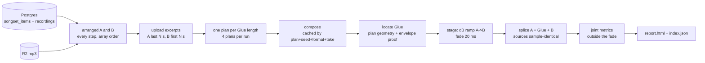

# ElevenLabs instrumental Glue POC — implementation summary

Branch `sow_transition_inprint_elevenlabs`. Commits: `0206a313` (script, tests, pyproject,
CONTEXT), `75902e87` (exact seam search), `448f254f` (paid-plan run + re-render findings),
`a2906404` (credit record), `c7456913` (metric/junction fixes, response and rejection caches),
`47465350` (graph). Run measurements live in `reports/elevenlabs_glue_poc_v1_results.md`; the API
facts live in `reports/elevenlabs_inpainting_api_guide.md` (its "Measured" section). This document
covers what was built and where it departs from the approved plan.

Deliverable: `lab/poc-scripts/gen_elevenlabs_glue.py` (2,127 lines) with
`lab/poc-scripts/tests/test_gen_elevenlabs_glue.py` (577 lines, 19 offline tests), the
`elevenlabs_glue` extra, and the `Glue` glossary entry in `CONTEXT.md`.

## 1. Pipeline



Module sections, in order: env/DB/R2 helpers (`load_env_file`, `require_env`, `fetch_songset`,
`ensure_source_audio`), audio I/O (`decode_audio`, `read_wav`, `write_flac`, `pcm16_and_sha`),
take geometry (`take_specs`, `beat_seconds`), plan (`glue_chunk`, `build_plan`), windows
(`arrangement_windows`, `plan_total_seconds`, `check_plan_total`), API (`_fatal_from_response`,
`upload_song`, `compose`, `compose_cached`, `response_key`), caches (`load_uploads`,
`ensure_upload`), decode (`decode_seam`), location (`best_offset`, `block_envelope`,
`envelope_correlation`, `envelope_offset`, `locate_glue`), shaping (`take_tail`, `stage_edges`,
`apply_fades`, `splice`), metrics (`joint_metrics`, `evaluate_status`), report (`report_html`,
`metric_text`, `card_html`, inline CSS/JS), CLI (`parse_args`, `dry_run`, `main`, `_execute_run`).

Invariants enforced in code, every take: `splice[:len(a)] == a` and `splice[-len(b):] == b` by
sample; the Glue is the only new audio; a take that cannot be produced is written to
`index.json`/`report.html` as `failed` with its measured numbers and error text; a fatal API
response exits 2 and leaves `failure.json` (cleared on a later `--force` reuse).

## 2. Where the implementation departs from the plan

| Plan said | Built | Why |
|---|---|---|
| Upload both **full** arranged sides (4,858 credits) | `--upload-seconds N` uploads A's last / B's first N s (12 s used) | The copyright screen rejects a full commercial arrangement with HTTP 400 and keeps half the fee; excerpts of the same audio upload |
| Locate the Glue by Pearson over lags; `r_a`/`r_b` ≥ 0.95 proves refs unchanged | Correlation kept as a fast path; when it cannot reach 0.95, plan geometry places the Glue and a 50 ms **energy-envelope** correlation (floor 0.90) proves identity | The API re-renders ref chunks: waveform r 0.25–0.47, envelope r 0.96–0.99, levels within 0.1 dB |
| `generated` shorter than target ⇒ take `failed` | Shortfall ≤ 100 ms keeps the whole response, flagged `generation_short_ms`; larger still fails | A 13 ms shortfall killed a paid take on the first real run |
| Joint metrics on the spliced pair at both joints, L/R implied by the report | Mono mix, keys `a`/`b`, reasons "A joint"/"B joint"; 50 ms step windows skip the 20 ms fade | The fade alone reads −1.35 dB, and the metrics were never per-channel |
| `--context-seconds` narrows refs inside full uploads | Both flags kept: `--upload-seconds` decides what is uploaded, `--context-seconds` decides which sub-range a plan references | They answer different questions; the full-side path stays valid for non-commercial audio |
| Plan geometry places the Glue exactly | ±1 s envelope search measures each boundary (`measured_offset_a_ms`, `_b_ms`) | A response can be a few ms off plan; every take measured 0 ms at 50 ms resolution |
| (not planned) | `cache/responses/` keyed by `(plan body, seed, format, take)`; `--refresh-responses` bypasses it | Compose is paid and not reproducible: 2- and 4-beat takes send an identical body and returned different audio, so the take id must be in the key |
| (not planned) | Copyright rejections cached in `uploads.json` by audio hash; a rerun refuses unless `--refresh-uploads` | Prevents silently re-paying the half fee |
| Plan totals 326.82 / 326.82 / 329.39 / 334.97 s | Plan totals 27.00 / 27.00 / 29.57 / 35.15 s | The totals are refs + generation; with 12 s refs instead of 146.51/177.31 s the plan is short. Full-pair length does not depend on the refs: it is `A + glue + B`, i.e. 325.213 s for the 2-beat baseline plus `target − 1.3932` per longer take |
| Growth of the full pair: the plan's verification expected 325.21 / 325.61 / 328.39 / 333.97 s | Measured 325.213 / 326.606 / 329.393 / 334.966 s | The plan's expectations were arithmetically wrong (≈1 s short from 4 beats on, not one glue length); the measured values satisfy `A + glue + B` to the sample, so the splice is right and the older expectations were not |

New flags relative to the plan: `--upload-seconds`, `--refresh-responses`. `--refresh-uploads` now
also clears a cached rejection.

## 3. Verification (all run on this host)

```bash
uv run --python 3.11 --project lab/poc-scripts --extra elevenlabs_glue --extra test \
  pytest lab/poc-scripts/tests/test_gen_elevenlabs_glue.py -q     # 19 passed
uv run --python 3.11 --project lab/poc-scripts --extra elevenlabs_glue --extra test \
  python -m ruff check lab/poc-scripts/gen_elevenlabs_glue.py \
  lab/poc-scripts/tests/test_gen_elevenlabs_glue.py              # clean
uv run --python 3.11 --with black black --line-length 100 --check \
  lab/poc-scripts/gen_elevenlabs_glue.py lab/poc-scripts/tests/test_gen_elevenlabs_glue.py  # clean
```

`--dry-run` prints the four take rows, the plan JSONs and the credit estimate without network or
writes (defaults are full-side refs: totals 326.82/326.82/329.39/334.97 s, 4,857 upload + 341
generation = 5,198 credits; the plan estimated 1,363 for generation, 4× the actual 341). The real run
(`--run-name run1 --upload-seconds 12`) produced, checked with `ffprobe`:

| Artifact | Seconds |
|---|---|
| `context/a-arranged.flac`, `context/b-arranged.flac` | 146.510, 177.310 |
| `glues/beats-2-generation.flac` (raw, untrimmed) | 3.000 |
| `seams/baseline.flac`, `seams/beats-2/4/8/16.flac` | 31.393, 31.393, 32.786, 35.573, 41.146 |
| `full/baseline.flac`, `full/beats-2/4/8/16.flac` | 325.213, 325.213, 326.606, 329.393, 334.966 |

`full/beats-2.flac` re-checked bit-exact against the source outside the Glue. All 20 audio files
serve 200 `audio/flac` from `python -m http.server`; in headless Chrome the players advance,
the last-played bar and card badge update, and the metrics line shows `geometry`, `envelope` and
`offset` per take.

Credits: 2,141 spent in total — 1,099 on the rejected full-side upload, 360 on the excerpts, 682 on
generation (four composes paid twice: once before the locator fix). Regenerating the run after the
metric fixes cost 0 credits via the response cache.

## 4. Artifacts and review

`lab/poc-scripts/output/elevenlabs-glue/` (651 MB, gitignored): `cache/` (mp3/wav sources),
`uploads/` + `uploads.json`, `cache/responses/`, and per run `context/ plans/ responses/ glues/
full/ seams/ index.json report.html`.

```bash
cd lab/poc-scripts/output/elevenlabs-glue/run1 && python -m http.server 8092
# http://127.0.0.1:8092/report.html
```

## 5. Known limits / follow-ups

- The joint step is a 50 ms diagnostic on the mono mix: it exposes an attack at the Glue's start
  (beats-8/16 flag at +3.5 dB) but cannot distinguish "attack" from "gain mismatch" by itself. A
  short crossfade at the joints, or a fade aligned to the Glue's first onset, would remove both the
  beats-2 dip and the beats-8/16 attack flags; not implemented.
- `envelope_correlation` returns 0.0 when either envelope is flat, so a constant-level reference
  flags `check`. Only the 3 s boundary window is gated; the 12 s regions were measured separately
  as corroboration.
- The copyright screen's behaviour beyond one rejection is unknown (lengths, instrumental-only
  excerpts). A ~4 s probe upload would map it for ~60 credits.
- Wiring a Glue into Songset Preview/Listen or the Render Pipeline is out of scope for this POC.
- The run directory keeps `failure.json` only for the attempt that failed; a `--force` reuse now
  deletes a stale one (the first real attempt's rejection record was still there after the
  successful rerun and was removed).
