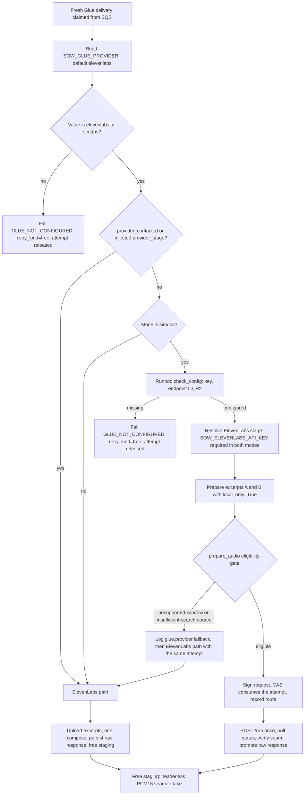

# Glue worker provider static routing explained

This document explains how one Glue (AI transition) job is served by exactly one of two back ends:
ElevenLabs (`music_v2_5`) or SimDPS-Multi on Runpod. It is an explainer for the routing rules, the
eligibility gate, the failure vocabulary and the operator telemetry. The rollout status, deployment
settings and verification results live in
[the SimDPS Runpod implementation summary](./simdps_glue_runpod_impl_summary.md) and the
[implementation spec](../specs/migrate_glue_sampler_to_runpod_v2.md); procedures live in the
[Glue operator runbook](../docs/glue-operator-runbook.md#runpod-staging-and-rollout).

Operational state: production runs `SOW_GLUE_PROVIDER=elevenlabs`; `simdps` is opt-in on the Glue
Lambda only, and cutover is still gated (runbook step 5 keeps production on `elevenlabs`, and the
implementation summary lists the remaining rollout gates including offline GPU model loading, real
R2 conditional PUT behaviour, the blinded listening verdict and cost approval). **There is no runtime
load balancing, no cost router and no cross-provider failover between providers.** What exists is a
static per-job selector plus a pre-contact eligibility gate: the provider is chosen once, before
spend, by an environment variable and a geometry/audio check — not by prioritization, latency
sampling, price or observed results.

Anchors below are `path:line` at the time of writing. The code in
`delivery/render-worker/src/sow_render_worker/` is authoritative over this text.

## One job, two back ends

| | ElevenLabs | SimDPS-Multi on Runpod |
|---|---|---|
| Selected when | Default; also whenever `SOW_GLUE_PROVIDER` is absent, `job.provider_contacted` is already true, an injected `provider_stage` is present, or the SimDPS eligibility gate declines (`glue_jobs.py:738-740`) | `SOW_GLUE_PROVIDER=simdps` and the pre-contact gate accepts the junction (`glue_jobs.py:738`, `glue_runpod.py:186`) |
| Transport code | `ElevenLabsHttpTransport` (`glue_provider.py:181`) via `create_provider_stage` (`glue_provider.py:722`) | `RunpodAPI` (`glue_runpod.py:331`) plus the GPU handler `delivery/simdps-worker/handler.py` |
| Outbound requests | `POST /v1/music/upload` per excerpt → `song_id` (`glue_provider.py:48`, `:209`), then one `POST /v1/music?output_format=pcm_44100` with model `music_v2_5` and a 3-chunk `composition_plan` (`build_compose_request`, `glue_provider.py:414`; output format `glue_provider.py:50`) | One `POST /run` on `https://api.runpod.ai/v2/{endpoint}` (`glue_runpod.py:501`) carrying signed R2 GETs for `montage.flac` / `guide.flac`, a create-only signed PUT for `seam.pcm`, frame counts and seed, plus `policy{"executionTimeout": 180000, "ttl": 330000}` (`sign_request`, `glue_runpod.py:298`) |
| Timeouts | connect 5 s, upload read 15 s, compose read 90 s (`glue_provider.py:52-54`); compose is never retried (`glue_provider.py:955`) | `POST /run` capped at 13 s, status polls 10 s reads, whole contact budget `API_SECONDS = 360` with `OUTCOME_SECONDS = 60` held back (`glue_runpod.py:47-48`, `:501`) |
| GPU work | none in-repo; provider-side generation | `inpaint(..., source=guide, method="multi", raw=True, seed, steps=100)` on `acestep-v15-base`, then a headerless stereo PCM16 seam PUT before returning (`delivery/simdps-worker/handler.py:177-215`; `STEPS = 100`, `simdps_audio.py:15`) |
| Inputs sent | Up to 12 s arranged excerpt per side as uploaded WAV | Montage FLAC = exact incoming-tempo A tail + digital-silence fill + B head, plus an up-to-18-arranged-second guide FLAC (PCM_24) |
| Artifact | Streamed compose bytes (RIFF WAV or headerless `pcm_44100`, both accepted by staging at `glue_staging.py:213-228`) | Headerless stereo PCM16, `4 * (a_frames + fill_frames + b_frames)` bytes |
| Verification | Legacy staging geometry checks in `finalize_staging` (`glue_staging.py:790`); excerpt copyright verdicts become negative cache entries (`glue_provider.py:881-897`) | Size, metadata, montage checksum, byte-for-byte A/B sample equality and fill level before promotion (`_verify_result`, `glue_runpod.py:378-405`) |
| Budget | `MAX_RESPONSE_BYTES = 32 MiB` compose cap, 120 s maximum generation (`glue_provider.py:56`, `glue_provider.py:439`) | 10 MB compressed input cap (`INPUT_CAP_BYTES`, `simdps_audio.py:16`), 32 MiB result cap, one submission per job |
| Attempt accounting | One paid attempt, consumed by the same CAS as SimDPS (`record_provider_contact`, `db.py:888`) | Same CAS, same single attempt |

Shared by both: `record_provider_contact` (`db.py:888`) is the single spend point — it consumes the
reserved attempt, records `provider_context_json`, and is the competing transition against
cancellation. Both paths converge afterwards on the same **free** staging stage
(`glue_staging.finalize_staging`, `glue_staging.py:790`), which only branches on
`provider_context_json.provider == "simdps"` to decide headerless PCM16 versus WAV decoding
(`glue_staging.py:390-391`).

## Selection is static, per job, and sticky



1. `SOW_GLUE_PROVIDER` is read inside `_run_generate_mode` for every fresh delivery, defaulting to
   `elevenlabs` (`glue_jobs.py:738`). Any other value fails the job as `GLUE_NOT_CONFIGURED` with
   `retry_kind="free"` before any provider contact (`glue_jobs.py:741-743`).
2. The ElevenLabs stage is resolved before the provider branch (`glue_jobs.py:746` via
   `_resolve_provider_stage`, `glue_jobs.py:540-552`), so `SOW_ELEVENLABS_API_KEY` is required in
   **both** modes. Runpod mode does not remove the ElevenLabs dependency.
3. `job.provider_contacted` or an injected `provider_stage` forces the ElevenLabs path
   (`glue_jobs.py:739-740`).
4. In `simdps` mode `glue_runpod.check_config()` runs first (`glue_jobs.py:745`) and raises a **free**
   `GLUE_NOT_CONFIGURED` when `RUNPOD_API_KEY`, `RUNPOD_ENDPOINT_ID` or R2 configuration is missing
   (`glue_runpod.py:78-90`). Missing Runpod configuration is never a silent re-route to ElevenLabs.
5. The winner is persisted by the contact compare-and-set together with the reserved attempt
   (`record_provider_contact`, `db.py:888`): one statement flips `provider_contacted`, sets
   `paid_reservation_state='consumed'`, moves the job phase and stores `provider_context_json`;
   the attempt ledger row goes `reserved → consumed`. After that the provider owns the attempt.
6. A contacted SimDPS job re-enters through `_run_contacted_simdps` using the stored
   `provider_context_json` (`glue_jobs.py:612`, `glue_jobs.py:665-683`), so flipping the environment
   variable or rolling back does not change provider, re-submit, or refund. Rolling back means fresh
   deliveries go to ElevenLabs; in-flight Runpod jobs finish on Runpod (runbook, "Runpod redrive and
   rollback").

## The eligibility gate

The gate runs only in `simdps` mode, only before contact, inside `glue_runpod.prepare_audio`
(`glue_runpod.py:186-238`).

- **Fill length.** Fill frames come from `generation_duration_ms(beats, toTempoBpm)`
  (`glue_descriptor.py:140-151`: at least 3 000 ms, half-up milliseconds) mapped to 44.1 kHz frames by
  `milliseconds_to_frames` (`glue_descriptor.py:135-137`).
- **Window check.** `latent_window(a, fill, b)` (`simdps_audio.py:23-34`) resamples the geometry to
  the 48 kHz model rate, uses hop `1920` and a window of `375 * 1920` samples, requires
  `0 < fs < fe < 375`, and raises otherwise; `prepare_audio` converts that into the reason
  `unsupported-window` (`glue_runpod.py:196`).
- **Guide source.** First up to 18 arranged seconds of
  `{recording_hash_prefix}/stems/instrumental.flac` (`search_source="instrumental_stem"`,
  `glue_runpod.py:206`). If the stem is missing or too short it falls back to the incoming mix
  rebuilt from the same arranged steps (`search_source="incoming_mix"`, `glue_runpod.py:215`).
  `search_candidates` (`simdps_audio.py:37-41`) then counts usable latent-search candidates; fewer
  than one yields the reason `insufficient-search-source` (`glue_runpod.py:224`, `:226`).
- **Outcome.** When `prepare_audio` returns a reason, `_run_generate_mode` logs
  `glue.provider.fallback` with `provider="elevenlabs"` and `reason=...` (`glue_jobs.py:803`), the
  ElevenLabs contact then stores that string as `route["fallback_reason"]` (`glue_jobs.py:842-843`),
  and the job keeps the **same single attempt**. The fallback re-prepares both excerpts on the
  standard path: the SimDPS preparation ran with `local_only=True` (`glue_jobs.py:753-765`), where the
  excerpt cache short-circuits only for copyright rejections and never attaches a provider song id
  (`glue_excerpts.py:625`, `:663-666`). The standard preparation therefore runs in full, reusing
  already-persisted uploads and cached takes instead of re-uploading them.
- **Not a fallback.** Real storage, FFmpeg or configuration failures during preparation stay free
  preparation failures (`GlueAudioUnavailable`, `GlueExcerptTooShort`, deadline refusals). In
  `simdps` mode the catch-all rewrites any other unexpected preparation error to
  `GLUE_WORKER_FAILED` with `retry_kind="free"` (`glue_jobs.py:880-885`) because those messages can
  carry infrastructure request details.
- **Provider failures never fall back.** Once contact happened, a provider failure is terminal for
  that attempt; there is no re-route to the other back end.

## Failure taxonomy

Worker-side outcomes (`_handle_failure`, `glue_jobs.py:342`, and `_finish_terminal`,
`glue_jobs.py:286`). "Attempt state" is the paid-attempt ledger: `released` through
`_release_unconsumed_reservation` (`glue_jobs.py:255`, guarded on `state='reserved'`), `consumed` by
the contact CAS, and never refunded afterwards.

| Trigger | Stable code | `retry_kind` | Attempt state |
|---|---|---|---|
| Invalid `SOW_GLUE_PROVIDER` | `GLUE_NOT_CONFIGURED` | `free` | released |
| Missing `SOW_ELEVENLABS_API_KEY` (both modes; `glue_jobs.py:871-874`) | `GLUE_NOT_CONFIGURED` | `free` | released |
| Missing Runpod key, endpoint or R2 in `simdps` (`glue_runpod.py:78-90`) | `GLUE_NOT_CONFIGURED` | `free` | released |
| Pre-contact deadline refusal (`require_deadline`, `glue_jobs.py:185-205`; Runpod variant `glue_jobs.py:780`) | `GLUE_EXECUTION_DEADLINE` | `free` | released |
| Unexpected `simdps` preparation error (`glue_jobs.py:884`) | `GLUE_WORKER_FAILED` | `free` | released |
| Recording rejected during excerpt preparation (`glue_jobs.py:760`, `glue_provider.py:824`) | `GLUE_COPYRIGHT_REJECTED` | `none` | released |
| CAS lost to cancel, another worker, or a stale junction | no code written by this delivery; `glue.provider.contact.lost` is logged | — | not consumed |
| Runpod `POST /run` → 401, 403, 404 (`glue_runpod.py:500-504`) | `GLUE_NOT_CONFIGURED` | `none` | **consumed** |
| Runpod `POST /run` → 400, 405, 413, 422 (`glue_runpod.py:500-504`) | `GLUE_WORKER_FAILED` | `none` | **consumed** |
| Ambiguous POST, or no usable status by the cutoff (`glue_runpod.py:477-478`) | `GLUE_PROVIDER_UNKNOWN` | `paid` | consumed |
| Terminal `FAILED` / `CANCELLED` / `TIMED_OUT` with no valid object (`glue_runpod.py:461-463`, `:473-475`) | `GLUE_WORKER_FAILED` | `paid` | consumed |
| Seam failed verification: metadata, A/B bytes, or level (`glue_runpod.py:547-549`) | `GLUE_WORKER_FAILED` | `paid` | consumed |
| Duplicate delivery in flight with no durable raw response (`_handle_redelivery`, `glue_jobs.py:641-661`) | `GLUE_PROVIDER_UNKNOWN` | `paid` | consumed |
| Staging failure after a verified raw response (`_worker_error` default `retry_kind="free"`, `glue_staging.py:76`) | `GLUE_WORKER_FAILED` | `free` | consumed |
| Unverifiable raw metadata, or structurally invalid stored descriptor (`glue_staging.py:784-786`, `:819-823`) | `GLUE_WORKER_FAILED` | `none` | consumed |

`_handle_failure` defaults to `retry_kind = "paid" if contacted else "free"` (`glue_jobs.py:353`)
before consulting the exception's own class.

ElevenLabs provider errors are typed classes (`glue_provider.py:106-165`); `ProviderNotSent` is
retried in-process first (initial plus at most three capped attempts,
`glue_provider.py:61-62`, `:681-697`).

| Provider error | Stable code | `retry_kind` |
|---|---|---|
| `ProviderNotSent` (connection setup failed, nothing left the process) | `GLUE_WORKER_FAILED` | `free` |
| `ProviderAmbiguous` (bytes may have left; a repeat may be charged) | `GLUE_PROVIDER_UNKNOWN` | `paid` |
| `ProviderResponseTooLarge` (compose stream over 32 MiB) | `GLUE_PROVIDER_UNKNOWN` | `paid` |
| `ProviderEntitlement` (401/402/403 or plan/permission body) | `GLUE_PROVIDER_ENTITLEMENT` | `none` |
| `ProviderPlan` (422, or 413/415 upload format rejection) | `GLUE_PROVIDER_PLAN` | `none` |
| `ProviderCopyright` | `GLUE_COPYRIGHT_REJECTED` | `none` |

### Consequences worth knowing

- A Runpod `POST /run` rejection after contact ends as `GLUE_NOT_CONFIGURED` with
  `retry_kind="none"`. The editor renders that code as "AI transitions are not available on this
  server." (`glue.error.notConfigured`,
  `delivery/webapp/src/lib/i18n/messages/glue.ts:61`, mapped by `glueErrorMessageKey`), and because
  `canGenerateGlue` requires `!nonRetryableGlueFailure`
  (`delivery/webapp/src/components/songset/ArrangementEditorSheet.tsx:1676-1685`), no generate button
  appears for that junction while the failed job is current.
- A post-contact failure with `retry_kind="free"` and no persisted raw response still shows the free
  retry rail — heading "Try again without using another attempt", body "The AI audio was already
  created. Retrying it does not use another attempt." and action "Try again"
  (`ArrangementEditorSheet.tsx:1665-1675`, `:3345-3364`; copy at
  `delivery/webapp/src/lib/i18n/messages/glue.ts:113-122`) — because `freeRetryUsesProcessing` only
  checks `providerContacted`. `prepareRetryProcessing` then rejects it with `no-raw-response`
  (`delivery/webapp/src/lib/glue/jobs.ts:764-777`) until a raw response exists.

## What the user sees

Attempt accounting is provider-blind. The quote returns `generationSeconds`,
`quotaLimit`/`quotaUsed`/`quotaRemaining`/`quotaResetAt` and `blockedSides`
(`delivery/webapp/src/lib/glue/quote.ts:66-106`, consumed in
`ArrangementEditorSheet.tsx:134-145`) and never a provider name or credit estimate. The limit is 5
paid attempts per rolling 24 hours (`delivery/webapp/src/lib/glue/quota.ts:10`); the QA user id 15 is
exempt (`quota.ts:22-24`). The confirm copy is "This uses one AI transition attempt. {remaining} of
{limit} attempts remain." (`lib/i18n/messages/glue.ts:107-108`).

A pre-contact fallback does not add a second attempt: the fallback happens inside the same delivery
before the single contact CAS, so the user sees one attempt used and one take produced.

Free work, in the code's own terms:

- Compatible cached take reuse: for `takeMode: "initial"` the resolver returns an existing ready
  selection or newest compatible ready take before any reservation (`createGlueJob` step 5,
  `lib/glue/jobs.ts:1018-1030`).
- `retry-processing`: free staging replay of a persisted raw response (`lib/glue/jobs.ts:764-790`).
- Redispatch of a job that never reached a provider (`phase = 'dispatch-failed'`,
  `lib/glue/jobs.ts:735-759`).

## Worked example

One songset, two junctions, production numbers. The duration helper's floor dominates the first
junction: 4 beats at an incoming 86.13 BPM gives `max(3.0, 4 * 60 / 86.13)` = 3.000 s →
3 000 ms → **132 300 frames** (`glue_descriptor.py:140-151`, `:135-137`). The same beats without the
floor are the POC fixture's 122 880 frames. A tail and B head are each up to 12 s = 529 200 frames,
so the montage is 529 200 + 132 300 + 529 200 = 1 190 700 frames, and the seam is
`4 * (a + fill + b)` = 4 762 800 bytes (about 4.5 MiB, inside the spec's "at most about 6.6 MB"
statement and far below the 32 MiB result cap).

### Junction 1 — eligible, served by Runpod

| User action | API / worker step | Provider | Observable result |
|---|---|---|---|
| Opens the junction | Quote computed server-side | none | `generationSeconds` 3.000000, remaining attempts shown |
| Clicks create, confirms | `POST /api/glue-jobs` reserves one attempt, enqueues to SQS | none | Confirm copy follows `glue.confirm.body` |
| — | Worker claims the delivery, rebuilds and revalidates the junction, reads `SOW_GLUE_PROVIDER=simdps`, `check_config()` passes | none | `glue.job.claimed` |
| — | Both excerpts prepared `local_only=True`; `prepare_audio` window passes, instrumental stem present, candidates ≥ 1 | none | Heartbeats `local-excerpt-a`, `local-excerpt-b` |
| — | `stage_inputs` writes `montage.flac` and `guide.flac` with `IfNoneMatch="*"`, `sign_request` signs GETs plus a create-only PUT, deadline check passes, CAS consumes the attempt and stores the route | none | `glue.provider.contact.started` with `provider=simdps` |
| — | One `POST /run`; poll `status/{id}` | Runpod L4 runs `inpaint` with the saved seed at 100 steps and PUTs the seam | `glue.runpod.terminal` with status plus `model_load_seconds`, `sampling_seconds`, `processing_seconds` |
| — | Reads `seam.pcm`, verifies metadata/checksum/A-B bytes/level, promotes to the immutable raw store, then free staging | none | Take becomes `ready` |
| Sees the new transition selected | — | — | One attempt consumed; no provider name shown |

Wall-clock expectation: the configured budgets are 180 s Runpod execution, 330 s job lifetime, and a
360 s Lambda contact budget with a 60 s outcome reserve; the launch target is acceptance-to-ready p95
at most 60 s. The measured POC reference is 29.655 s sampling and 130.441 s cold elapsed for a remote
call including worker startup (`reports/simdps_glue_poc_impl_summary.md`). Per-junction figures in
the table above are illustrative, not measured for this junction.

### Junction 2 — ineligible, served by ElevenLabs

| User action | API / worker step | Provider | Observable result |
|---|---|---|---|
| Opens the second junction | Quote computed server-side | none | Same provider-blind quote |
| Clicks create, confirms | One attempt reserved, job enqueued | none | — |
| — | Worker selects `simdps`; the incoming recording has no instrumental stem and the mix yields zero latent-search candidates | none | `prepare_audio` returns reason `insufficient-search-source` |
| — | `glue.provider.fallback` logged with `provider="elevenlabs"`, `reason="insufficient-search-source"` | none | No attempt consumed yet |
| — | Both excerpts re-prepared on the standard path; uploads exist (cached uploads reused where present); CAS consumes the attempt and stores `provider_context_json` with `provider="elevenlabs"` and `fallback_reason="insufficient-search-source"` | ElevenLabs | `glue.provider.contact.started` with `provider=elevenlabs` |
| — | One compose with the 3-chunk plan, raw response persisted, free staging | ElevenLabs | Take becomes `ready` |
| Sees the new transition selected | — | — | Same one attempt; `fallback_reason` is only visible to operators |

"Try another" (`glue.job.tryAnother`, `lib/i18n/messages/glue.ts:100`) sends
`takeMode: "new-take"`, which requests a fresh paid attempt and replaces the junction's selection
only if generation succeeds (`glue.confirm.tryAnotherBody`,
`lib/i18n/messages/glue.ts:109-110`; `takeMode` handling in `lib/glue/jobs.ts:975-1065`).

## Operator telemetry and cost split

Log events to grep (Lambda CloudWatch, one JSON line each):

| Event | Where | Fields to read |
|---|---|---|
| `glue.provider.contact.started` | `glue_jobs.py:789`, `:855` | `provider`, `attemptId`, `searchSource` or `operation` |
| `glue.provider.fallback` | `glue_jobs.py:803` | `reason` (`unsupported-window`, `insufficient-search-source`) |
| `glue.provider.contact.lost` | `glue_jobs.py` `_record_contact_loss` | — (cancellation or another worker won the CAS) |
| `glue.runpod.rejected` | `glue_runpod.py:503` | `providerStatus`, `errorCode` |
| `glue.runpod.terminal` | `glue_runpod.py:457` | `status`, plus `model_load_seconds`, `sampling_seconds`, `processing_seconds` |

The recorded route lives in `glue_jobs.provider_context_json` and is written by
`glue_runpod.stage_inputs` and the ElevenLabs contact branch. Keys: `version`, `provider`, `model`,
`steps`, `upstream_revision`, `checkpoint_revision`, `endpoint_id`, `submission_id`, `a_frames`,
`fill_frames`, `b_frames`, `guide_frames`, `seed`, `search_source`, `montage_key`, `montage_sha256`,
`guide_key`, `guide_sha256`, `result_key`, `deadline_epoch`, `runpod_job_id`, and `fallback_reason`
on ElevenLabs routes only.

One job:

```sql
SELECT provider_context_json->>'provider'        AS provider,
       provider_context_json->>'model'           AS model,
       provider_context_json->>'fallback_reason' AS fallback_reason,
       provider_context_json->>'search_source'   AS search_source,
       provider_context_json->>'runpod_job_id'   AS runpod_job_id
FROM glue_jobs WHERE id = '<glue_jobs.id>';
```

Spend split over a window:

```sql
SELECT coalesce(provider_context_json->>'provider', 'legacy-elevenlabs') AS provider,
       provider_context_json->>'fallback_reason' AS fallback_reason,
       count(*) AS attempts
FROM glue_jobs
WHERE provider_contacted AND created_at >= now() - interval '30 days'
GROUP BY 1, 2 ORDER BY attempts DESC;
```

A null `provider_context_json` on a contacted legacy row reads as ElevenLabs. Rows with a
`fallback_reason` are ElevenLabs spend incurred inside a `simdps` period — they are selected for
ineligibility, not for load balancing.

## What this document does not claim

- No staging or production evidence for the Runpod path. Offline GPU model loading, inference on a
  real L4 endpoint, real R2 conditional-PUT and expiry behaviour, the blinded listening verdict and
  cost approval remain open per the rollout gates in
  [the implementation summary](./simdps_glue_runpod_impl_summary.md) and runbook steps 4-7 of
  [Runpod staging and rollout](../docs/glue-operator-runbook.md#runpod-staging-and-rollout).
- No latency guarantee beyond the configured budgets (180 s execution, 330 s job lifetime, 360 s
  contact budget, 60 s outcome reserve). The POC numbers are a single measured reference, not a
  distribution.
- No client-visible provider label, by design: the API and editor expose attempts and audio only, so
  the provider can be changed without a client contract change.
