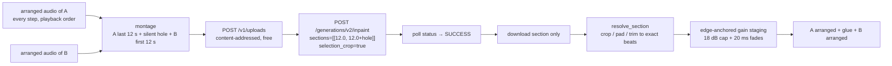

# Treblo junction-Glue POC — implementation summary

Branch `sow_treblo_inpaint_poc`, pushed to `origin`. Commits: `6d8a5227` (script, tests, tag
vocabulary, docs), `f71d32e2` (submit/upload hardening + docs corrected against the official
reference), `772f7114` (this summary, plus the copy-fidelity and level corrections).

Goal: use Treblo's `POST /v1/generations/v2/inpaint` as the generation engine for the seam glue —
generate one instrumental Glue for the junction between two Songs of a Songset, splice it between
two sample-identical arranged Songs, and let a listening page show the result or the refusal.

Outcome: **the pipeline works end to end; the vendor returned near-digital silence.** `run2`
submitted, polled, downloaded, cropped, staged, spliced and reported for 100 of the 3000 credits,
and the raw returned section measured **−88.52 dBFS RMS** (peak 0.0015; a faint 0.17 s onset at
−75.71 dBFS over a −103.50 dBFS remainder), so the take was refused by the level gate rather than
spliced. That is the recorded result of this POC, not a defect in the splice path.

## 1. Why the plan changed shape before any code

The approved plan assumed `[ A arranged 12 s ][ silent hole ][ B arranged 12 s ]` could be uploaded
for the default songset `hbWfCccGxN_JLQGBEqmdu`. It cannot: `POST /v1/uploads` answers HTTP 422
`{"detail":"This upload matches existing audio and cannot be used."}` for both of that songset's
recordings (`6a410a5c222a` Here I Bow, `20379e26256` Here for You) — and it does so for the plain
12 s recording heads, for every offset tried, and after an mp3 re-encode. This is vendor content
matching against material Treblo already holds, not a size, format or tag problem.

Free upload probes over the arranged songsets in the library (`fetch_songset` → `arranged_audio` →
`build_montage` → `treblo_upload`, the exact montage the paid run sends):

| songset | j1 | j2 |
|---|---|---|
| `hbWfCccGxN_JLQGBEqmdu` Small Group Morning Fortress | ✗ 422 | — |
| `i3-Ps8YpofpBmJ8_rNLzN` Test Arrangement | ✗ 422 | ✗ 422 |
| `2ZV5SHjAzw7ceJE-nREs2` Friday Worship - Arranged | ✗ 422 | **✓ 200** |
| `oQLbFBCtkoeWRMewz5cja` Monday Worship - Arranged | ✗ 422 | ✗ 422 |

One junction of seven accepts its montage. Passing is incidental, not a property of a recording: a
first-window probe of the same recording can return 200 while its own 40–52 s window returns 422, so
the guard fingerprints the exact audio sent. **The paid run therefore used `2ZV5SHjAzw7ceJE-nREs2`
junction 2** — the same 4-beat Glue, the same splice, one junction instead of two. Transform or
re-encode workarounds to defeat that filter were ruled out: that is circumventing a rights guard, not
a POC.

## 2. How the script works



- **Glue length is whole beats of the incoming tempo**, not a generation floor: 4 beats at
  69.8 BPM = 3.43839 s = 151,633 frames. `--beats` takes a comma list.
- **One paid response is never bought twice.** `response_key` hashes the endpoint, the whole request
  body and the take id; `<key>.request.json` is written immediately after a successful submit, so an
  interrupted run polls the saved task id instead of resubmitting. That is exactly what happened
  here: the first attempt died on a status-parse bug after the task was already submitted, and
  `--force` resumed task `c80da03a-…` rather than spending a second 100 credits.
- **The returned section is not sample-exact.** Measured 3.3437 s for a 3.4384 s request (Δ
  −94.717 ms), so `resolve_section` zero-pads (or trims) the tail to the requested length and records
  `padded_ms`/`trimmed_ms`/`section_delta_ms`. The pad is silent by construction; a take whose level
  is dominated by it fails the gate, which is what caught `run2`.
- **Tags are the closed v2 vocabulary** in `data/treblo-v2-tags.txt` (4,160 entries), validated
  before any request, in `dry_run` too. An off-list tag is a 422 and a rejected request is not
  charged, so this is a pre-flight check, not a runtime surprise.
- **Uploads expire** ("about 24 hours"), and `uploads.json` used to hand a dead `audio_upload_id` to a
  later paid submit. `_upload_is_fresh` treats anything older than 20 h (or undatable) as a cache miss
  and re-uploads; uploading is free.
- **The submit handle is never lost.** `treblo_submit` accepts `task_id`, `id` or `job_id` and
  otherwise raises `ApiFatalError` quoting the body — a bare `KeyError` after a charged POST would
  orphan the only handle on spent credits.
- **Refusals, not silent dropouts.** A glue below `-50 dBFS`, non-finite samples, a section length off
  by more than 100 ms, a residual above 6 dB after the 18 dB edge ramp, or a joint step above 3 dB
  marks the take `failed`/`check` with the measured numbers, and the report page shows it.

## 3. Files

| file | change | lines |
|---|---|---|
| `lab/poc-scripts/gen_glue_treblo.py` | new: montage/section-replace engine — `GlueSpec`/`glue_specs`, `build_montage`, `inpaint_body`, `treblo_upload`, `treblo_submit`, `treblo_status`, `treblo_task`, `treblo_wait`, `treblo_download`, `response_key`, `treblo_generate_cached`, `resolve_section`, `evaluate_status`, `stage_edges`, `apply_fades`, `splice`, `mix_songset`, `assemble_set`, `report_html`, `_execute_run`, `dry_run`; the engine-independent harness (`load_env_file`, `decode_audio`, `read_wav`, `write_flac`, `arranged_audio`, `fetch_songset`, `ensure_source_audio`, `joint_metrics`, the HTML/CSS/JS report blocks) is copied from `gen_elevenlabs_glue.py` | 2,510 |
| `lab/poc-scripts/tests/test_gen_glue_treblo.py` | new: 23 synthetic-audio tests, no network, no DB, no R2 | 595 |
| `lab/poc-scripts/data/treblo-v2-tags.txt` | new: the closed v2 tag vocabulary (4,160 entries) the API accepts; `TAG_FILE` is read at runtime | 4,160 |
| `lab/poc-scripts/pyproject.toml` | `glue_treblo` extra (`requests`, `numpy`, `soundfile` — no librosa/scipy/modal/openai) | +1 |
| `lab/poc-scripts/README-inpaint-poc.md` | the script's row in the table, flag reference, artifact layout, prerequisites, the measured result and the two untested hypotheses | +14 |

`gen_glue_elevenlabs.py` (renamed from `gen_elevenlabs_glue.py` in `4712944e`, an ancestor of this
branch) and its tests are untouched. `gen_audio_inpaint.py` was read-only reference. The tag file was
present in the worktree (the plan's input, not mine); it is committed because the script cannot run
without it.

Copied-block fidelity, re-checked with `inspect.getsource` against `gen_glue_elevenlabs.py` at this
commit: `context_card_html`, `ranking_table`, `full_set_card_html`, `_num`, `_audio` and `CSS` are
**identical**; `JS` differs only in the localStorage namespace (`sow.elevenlabs-glue:` →
`sow.treblo-glue:`); `card_html` differs in exactly three places —

1. a deliberate label change, `Generation (raw)` → `Section (returned)`, since the endpoint returns the
   replaced section rather than a separate generation;
2. the refusal-line fix from §7 (the copy prints the take's own status, the source still hardcodes
   `check:`);
3. one `ruff format` f-string quote rewrite (`take.get('summary')` → `take.get("summary")`).

So `card_html` is *not* byte-identical. Difference 3 is cosmetic; differences 1 and 2 are intentional,
and difference 2 means **the `check:` mislabel still exists in `gen_glue_elevenlabs.py:1675`** — that
file is untouched by design (the plan forbids modifying it and its 29 tests), so the bug is live there
for any ElevenLabs report whose take failed on reasons rather than on `error`. Porting the one-line fix
is out of scope for this branch and is worth a separate change.

That formatter delta is a known cosmetic wart, not a verification failure being papered over: `ruff
format --check` reports this file would be reformatted (the `sections.append(f"""…""")` wrapping plus
that quote style), and it reports the same for `gen_glue_elevenlabs.py`, because the repo ruff config
targets `py311` while the formatter applies `py312+` nested-quote rules. No CI formatter gate exists
for `poc-scripts` (`ci.yml` runs `ruff check --select F821,F841` on `admin-cli` only), so source
fidelity won over formatter cleanliness. `ruff check` is clean on both new files.

## 4. Measured result — the paid run

Run `run2`, songset `2ZV5SHjAzw7ceJE-nREs2` junction 2, 4 beats, one take, 100 credits.

| item | title | recording | arranged | BPM | key | steps |
|---|---|---|---|---|---|---|
| 0 | 我揚聲敬拜 | `f8cfc4464e96` | 237.56 s | 64.6 | D major | 5 |
| 1 | 祢的救恩 | `50f6419044cb` | 207.73 s | 66.3 | F# minor | 5 |
| 2 | 當祢走進我們當中 | `863331f713b5` | 109.64 s | 69.8 | F major | 2 |

Junction j2 = 祢的救恩 → 當祢走進我們當中. Montage 27.43839 s (12 s + 3.43839 s hole + 12 s),
4,840,176 bytes, sha256 `2162bad6…`, `audio_upload_id 2ae7ff90-…`. Task `c80da03a-b1ef-4c85-80da-d7bf257b0655`,
`model_version v2.2`, request `sections [[12.0, 15.43839]]`, `selection_crop true`,
`instrumental true`, `prompt_strength 2.0`, `balance_strength 0.7`, tags
`worship, praise & worship`, seed 0. Balance 3000 → 2900.

What came back, re-derived from the raw `.bin` in `cache/treblo-responses/`:

| measured | value |
|---|---|
| returned section | 147,456 frames = 3.3437 s (requested 3.43839 s, Δ −94.717 ms) |
| peak | 0.00152588 = 50 / 32768 |
| RMS, returned section overall | −88.52 dBFS |
| RMS, first 0.17 s | −75.71 dBFS (the only non-noise content) |
| RMS, remainder | −103.50 dBFS |
| `glue_rms_db` recorded (padded raw section, **pre-staging**) | −88.628 dBFS |
| staged + faded glue (what would be spliced) | −82.767 dBFS, peak 0.002411 |
| staging | requested +59.686 / +78.390 dB, clamped to 18 / 18 dB, residuals 41.686 / 60.390 dB |
| joints | A step −66.032 dB (jump_ratio 2.229); B step +208.632 dB |
| status | `failed` — "glue level -88.628 dBFS is below -50 dBFS" |

`glue_rms_db` is measured on the returned section after the pad and *before* `stage_edges`, so −88.628
is a property of the vendor's audio, not of the staging. Staging then lifted it to −82.767 dBFS and the
splice would have produced `junctions/j2/full/beats-4.flac` at −14.715 dBFS — which is why the gate
matters: those two numbers look plausible at a glance and only the pre-staging level exposes that no
music is in the glue.

So the vendor's own bytes are near-silence with a faint onset transient, not a copy of the hole
(the hole slice is exactly 0.0). The geometry, crop, pad, staging and gate all behaved as designed;
the model simply did not write music into the masked region.

**Two rival explanations remain untested — do not assume one:**

1. *Silence in the hole.* v2 appears to treat the masked region's digital zeros as content to keep.
   The discriminating probe is one request over a section holding **real** audio from the same cached
   upload (`sections [[0.0, 3.44]]` over A's tail): real music back means the hole content was the
   cause.
2. *`instrumental: true` inpaint.* Every historically working v2 inpaint configuration known uses
   `tags` plus `lyrics` with `instrumental: false`; no working instrumental-mode inpaint has been
   observed. If (1) also fails, this is the remaining suspect.

Either probe costs another 100 credits. Neither has been run.

## 5. Corrections made against the official reference

The vendor documentation contradicts two things that were easy to assume, and both mattered for
diagnosis:

- `balance_strength` is **vocal naturalness vs. instrumental sharpness** (higher = more natural
  vocals), *not* a reference/hole weighting. The README and the `--balance-strength` help text said
  "reference/hole balance", which made "sweep balance_strength low" look like a plausible fix for the
  silence. Both are corrected.
- v2 inpaint **rejects `prompt`** outright; it wants `tags` plus either `lyrics` or
  `instrumental: true`. The request body never sent one, so this was documentation risk, not a bug.
- v3 exposes `operation: replace|insert` plus `prefix_context_seconds`/`suffix_context_seconds` in
  the OpenAPI schema, but the docs state section replacement runs on **v2 only** ("replace for v3 is
  coming soon"). There is no second endpoint to fall back to today.

## 6. Bugs found and fixed while running

- **`treblo_status` parsed the body twice.** `GET /generations/status/{id}` returns the JSON *string*
  `"TRANSCRIBE_STAGE_1"`; `resp.json()` already decodes that to a `str`, then `json.loads()` on the
  string raised `Expecting value: line 1 column 1` on every poll, so a submitted-and-charged task
  failed as a take. Deterministic, not a flake. Fixed to use the decoded value and to treat an empty
  or unparseable body as "still running" (`PENDING`) — never a failed take.
- **Shared `.venv` thrash.** `uv run` with different `--extra` sets recreated
  `lab/poc-scripts/.venv` mid-run three times; `requests`/`certifi` vanished and two probes died on
  `ModuleNotFoundError` / `OSError: … certifi/cacert.pem`. Worked around with
  `UV_PROJECT_ENVIRONMENT=/tmp/treblo-venv`; not a code bug, and the repo env is intact now.
- **`fatal()` skipped `failure.json`.** The in-loop fatal path wrote `index.json` + `report.html` but
  not `failure.json`, contradicting the documented contract. Extracted `_write_failure` and call it
  from both `fatal()` and `main`'s handler.
- **The 422 hint conflated two cases.** The upload guard's content-match 422 used to be explained as
  "the tag file is stale". It now branches on `matches existing audio` and says the recording is
  blocked and the fix is a different song — never transformed audio.

## 7. Verification performed — and what did not match the plan

Performed:

- `uv run --project lab/poc-scripts --python 3.12 --extra glue_treblo --extra test python -m pytest
  lab/poc-scripts/tests/test_gen_glue_treblo.py -q` → **23 passed**. Covers montage geometry and its
  invariants (sides byte-identical, hole all zeros, 40 MB cap), `glue_specs` exactness and the 0.1 s
  floor, body key set for both instrumental and lyrics modes, tag validation against the real file,
  all three `resolve_section` geometries plus the reject path, cache reuse and resume-from-saved-task
  (asserting no resubmit and no repoll), status parsing for all four documented shapes, submit with a
  renamed task id, upload TTL and stale-id re-upload, `evaluate_status` rules, splice invariants,
  report rendering, and that `--dry-run` writes nothing and touches no network.
- `ruff check` clean on both new files.
- `--dry-run --dry-run-items 3 --junctions 2` reproduces the geometry, the credits line and the exact
  request body without Postgres, R2 or the API.
- `--help` shows the corrected `--balance-strength` semantics.
- The paid run is the end-to-end proof of the *pipeline*: upload → submit → poll
  (`TRANSCRIBE_STAGE_1` → `SUCCESS`) → download → `resolve_section` → stage → splice → `index.json` +
  `report.html`, with `credits_spent: 100` in the index and the balance confirmed at 2900 by
  `GET /v1/credits/balance`.
- **Report page in a real browser** (`python -m http.server 8094` in `run2/`, headless Chromium at
  `http://127.0.0.1:8094/report.html`): 10 `<audio>` elements, all 10 `src`s resolved to the files on
  disk with finite `duration` after forcing load of the `preload="none"` players — context
  237.56 / 207.73 / 109.64 s, `full-set/baseline.flac` 558.459 s, j2 baseline seam 31.719 s, j2
  baseline full 319.089 s, glued section 3.43839 s, staged glue 3.43839 s, seam excerpt 33.438 s, full
  pair 320.808 s, no `MediaError`. Playback advanced (`currentTime` 2.0 → 0.851 s after 0.9 s — the
  element wrapped the short excerpt rather than stalling, `paused: false`). 5 take cards
  (`full-set-baseline`, `j2-baseline`, `j2-beats-4`, and the two ranking-table repeats); the "Failed
  takes" section renders `failed: glue level -88.628 dBFS is below -50 dBFS`; the subtitle reads
  `engine treblo · POST /generations/v2/inpaint · model v2.2 · tags worship, praise & worship ·
  instrumental yes · prompt_strength 2.00 · balance_strength 0.70 · selection_crop yes · 12.00 s
  sides · 100/100 credits`.
- The browser check found a rendering bug the unit tests did not: `card_html` hardcoded the prefix
  `check:` on the reasons line, so a `failed` take displayed `check: glue level -88.628 dBFS is below
  -50 dBFS` — the label contradicted the take's own status. It now prints the status verbatim
  (`failed:`), regenerated `run2/report.html`, and re-verified in the browser with the cache
  disabled (`p.error` = `failed: glue level -88.628 dBFS is below -50 dBFS`, 10 players, 5 cards).
  23 tests still pass and `ruff check` is clean.

Where the executed work deviates from the approved plan, stated plainly:

| plan item | what actually happened |
|---|---|
| step 3, paid run on the default songset `hbWfCccGxN_JLQGBEqmdu`, both junctions, `run-name run1` | impossible — `POST /v1/uploads` 422s that songset's recordings. `run1` is the 0-credit failure record; the paid run is `run2` on `2ZV5SHjAzw7ceJE-nREs2` **junction 2 only** (the sole junction of seven that accepts its montage), after explicit user approval of the substitute |
| step 3 expected `takes: 1 (ok 1)` or `(check 1)`, `glue_seconds ≈ 2.786`, `full-set/beats-4.flac ≈ 326.6 s` | got `takes: 1 (failed 1)` — the take was refused at −88.628 dBFS; `glue_seconds` is 3.4384 (69.8 BPM, not 86.13281); `full-set/beats-4.flac` was never written because a junction subset skips full-set assembly (`full_set.skipped` recorded) |
| step 4, browser check of `report.html` | performed (§7 above) — durations finite, playback advances, subtitle matches |
| step 5, ≈19 tests | 23 tests, after three were added for the fixes in §6 |

## 8. Review surfaces

Runs live in `lab/poc-scripts/output/treblo-glue/` (git-ignored: `output/*`). `run2` is 171 MB; the
shared `cache/` is 503 MB, of which `cache/treblo-responses/` holds the paid bytes.

```bash
cd /home/mhuang/Development/sow_treblo_inpaint_poc/lab/poc-scripts/output/treblo-glue/run2
python -m http.server 8094
# http://127.0.0.1:8094/report.html
```

| run | songset | what it is | credits |
|---|---|---|---|
| `run1` | `hbWfCccGxN_JLQGBEqmdu` | default songset, died on the upload guard; `failure.json` records the 422 | 0 |
| `run2` | `2ZV5SHjAzw7ceJE-nREs2` j2 | the paid run; refused take, full artifact set | 100 |

`run2/` layout: `context/` (the three arranged sides), `full-set/baseline.flac`,
`junctions/j2/{montages,plans,responses,glues,full,seams}/`, `index.json`, `report.html`.
`full-set/beats-4.flac` is absent by design: a junction subset (`--junctions 2`) skips full-set
assembly and `index.json` records `full_set.skipped = "junction subset selected (--junctions)"`.

Reproduce (the paid run is the only credit-spending command):

```bash
cd /home/mhuang/Development/sow_treblo_inpaint_poc
set -a && . /opt/sow/.env && set +a
uv run --project lab/poc-scripts --python 3.12 --extra glue_treblo \
  python lab/poc-scripts/gen_glue_treblo.py \
  --songset 2ZV5SHjAzw7ceJE-nREs2 --junctions 2 --run-name run2 --force
```

`--out-root` defaults to `lab/poc-scripts/output/treblo-glue` relative to the cwd; `cache/` and
`uploads.json` are shared by every run under one root, so a rerun reuses the upload (free) and the
paid response instead of buying the same audio again.

## 9. Known limits / not done

- **The vendor returned near-silence**, so no listening judgement of Glue *quality* exists — only the
  geometry, staging, splice and refusal evidence. The two hypotheses in §4 are the next step and each
  costs 100 credits.
- **No tempo or key control** on v2 inpaint (no `bpm`/`key`/`negative_tags`), so the Glue cannot be
  requested in B's key. The joint and residual metrics are the evidence, not a key match; `librosa` is
  deliberately not a dependency of the `glue_treblo` extra.
- **Upload coverage is the binding constraint**: one of seven library junctions passes the guard, so a
  multi-junction run cannot be assembled from the current catalog.
- **Disk footprint is unbounded and unpruned.** `cache/` reached 503 MB for this work: 442 MB of decoded
  source WAVs (one per recording touched, 32–98 MB each at 44.1 kHz stereo PCM16) plus 61 MB of source
  mp3s, and `run2/` adds 171 MB. Nothing prunes it — the cache is shared across runs and kept so a rerun
  never re-downloads or re-decodes. A 5-song set touching five recordings, or a sweep over several
  songsets while hunting an uploadable junction, multiplies that linearly; there is no `--prune` flag.
- **`--takes`, `--beats` sweeps and `--no-instrumental --lyrics`** are implemented and unit-tested but
  have never been run against the live API — every live request so far used one take, 4 beats,
  instrumental mode.
- **Report page scoring UI is client-side only** (localStorage), unchanged from the ElevenLabs page.
