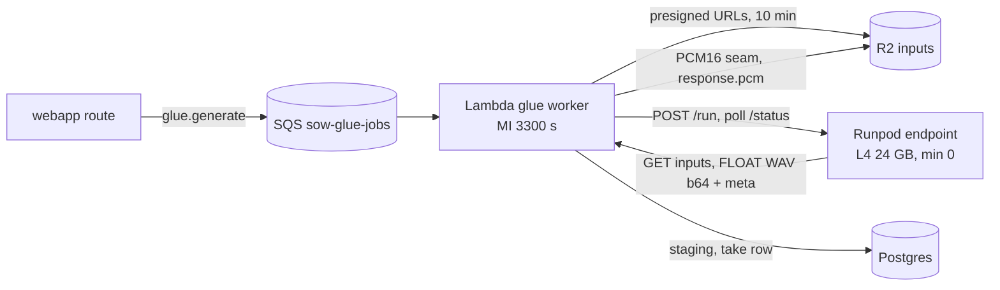

# SimDPS glue on a serverless GPU — evaluation and implementation plan

Audience: whoever implements the SimDPS replacement for the ElevenLabs Glue. Measured facts are
marked with their source; everything else is an estimate and says so.

## 1. Verdict

**GPU-less Lambda is technically admissible but economically absurd.** After the corrections below
the caps no longer decide it: the pruned model is 2.6 GB bf16 / 5.2 GB fp32, a CPU torch image fits
10 GB, and the glue worker already runs on Lambda **Managed Instances with a 3300 s timeout**, so a
single 15–45 min CPU fill would fit the function budget. What kills it is throughput and money:
15–45 min per junction at **$0.41–0.55 of CPU** versus ~35 s at **$0.005 of L4** (measured: 29.7 s
of sampling on an L4, 130 s cold on Modal). That is a 70–100× cost multiplier and a latency the
product cannot hide.

**Recommendation:** keep the Lambda glue worker as the orchestrator and move only the sampler to a
Runpod L4 endpoint behind `SOW_GLUE_PROVIDER=simdps`. Reversible seam, no schema change, no webapp
change.

## 2. Facts this plan rests on

| Fact | Value | Source |
|---|---|---|
| DiT parameters actually loaded | 1.31 B bf16 → 2.62 GB (`decoder.*` + `null_condition_emb` only); 5.2 GB fp32 | `simdps/priors/acestep.py:151-157`; checkpoint totals 2.39 B → 4.78 GB |
| VAE | `AutoencoderOobleck`, fp32, ~0.4 GB | `simdps/priors/acestep.py:208-214` |
| Model window | 375 latent frames × 1920 hop @ 48 kHz = **15.0 s** | `priors/acestep.py:47-48`, `inpainter.py:302-304` |
| Gap buffer | 20 latent frames = 0.8 s per side | `configs/experiment/ismir26_multi.yaml:6` |
| Sampler config | `multi`, `steps: 100`, `n: 15` candidates, `zeta: 0.5`, `jacobian: true`, `candidates.stop: 0.5` | same file |
| Guidance work | ~54 of 100 steps run guidance on 15 candidates with a backward (Jacobian) pass; ~46 run batch 1, no grad | `configs/experiment/ismir26_multi.yaml`, `simdps/guidance.py:96-104` |
| Implied work per fill | ≈1.6–2.4 PFLOP for a 2.8 s fill → 55–80 TFLOPS effective on the measured L4 | derived from the 29.655 s measurement below |
| Measured sampling, 4 beats @ 86.13 BPM, seed 0, 100 steps, L4 | **29.655 s** | `reports/simdps_glue_poc_impl_summary.md` |
| Measured cold remote call (Modal: download + load + sample) | **130.441 s** | same report |
| Fill produced | 122,880 stereo frames @ 44.1 kHz, sample-exact splice | same report |
| Payload, real artifacts | montage `beats-4.flac` **2,016,571 B**; POC guide (whole arranged stem) 16,091,303 B → production 12 s guide ≈ 2 MB | `lab/poc-scripts/output/simdps-glue/run1/junctions/j1/` |
| Glue worker runtime | Lambda **Managed Instances**, timeout **3300 s**, 3072 MB, 2048 MB ephemeral, 2 environments, SQS visibility 3500 s | `delivery/render-worker/README.md:400-420`, `deploy/aws-up-glue.sh:44-46,167-205` |
| Provider deadline reserves | upload 990 s, compose 1890 s | `specs/inpaint-transition-elevenlabs-v2.md:425`, `glue_jobs.require_deadline` |
| Provider stage seam | `provider_stage(job, conn, *, a_excerpt, b_excerpt, work_dir, log_event)` after the `record_provider_contact` CAS | `glue_jobs.py:811-818`, `db.py:876-899` |

## 3. Why not Lambda without a GPU

**3.1 What does *not* block it (corrected).** Memory: the loaded branch is 5.2 GB fp32, inside
Lambda's 10,240 MB (the worker's current 3072 MB must be raised). Image: a CPU torch wheel (~1 GB)
plus 5.2 GB of weights fits the 10 GB container cap. Time: the glue worker is on Managed Instances
with 3300 s, and one glue job is one junction, so even a 45 min CPU fill is inside the budget — with
no retry headroom at the top of the range.

**3.2 What does block it.**
- **Throughput.** ~1.6–2.4 PFLOP of guidance-dominated work per fill. 16 vCPU fp32 sustains
  1–2 TFLOPS on this workload at best (autograd + `is_grads_batched` vmap, no tensor cores), so
  **15–45 min per junction**. bf16 does not help unless the instance exposes AVX512-BF16/AMX;
  otherwise torch up-converts and it is slower than fp32.
- **Money.** See §9: $0.41–0.55 of CPU per glue versus $0.005 on a Runpod L4. "Drop the GPU to save
  money" is the opposite of true at this duty cycle.
- **Latency headroom.** A run at 45 min leaves 10 min of the 3300 s budget; a slow step ratio
  (bf16 fallback, thermal neighbours) lands on the deadline, which is a paid-ambiguous failure.

**3.3 Gate 0 — measure it, on representative hardware (~30 min, ≈$0.40).** Do not extrapolate from
this workstation: it is a 2-core Kaby Lake with no AVX-512/AMX and would mislead by an order of
magnitude. Launch a `c7i.4xlarge` (or the actual MI capacity provider's instance class), then:

```bash
# cpu_bench.py — real schedule, real window, explicit dtype (simdps.load() defaults to fp32 on CPU)
import soundfile as sf, torch, time
from simdps import Inpainter
from simdps.priors.acestep import ACEStep
m, sr = sf.read(".../montages/beats-4.flac", dtype="float32", always_2d=True)
for model, steps in (("base", 100), ("turbo", 7)):
    prior = ACEStep(model=model, device="cpu", dtype=torch.bfloat16)   # also run torch.float32 once
    inp = Inpainter(prior, cache_dir=None)
    gap = (12 * 44100, 12 * 44100 + 122880)
    t0 = time.perf_counter()
    r = inp.inpaint(torch.from_numpy(m.T.copy()), sr, tuple(g / sr for g in gap),
                    method="multi", raw=True, seed=0, steps=steps)
    print(model, steps, time.perf_counter() - t0, "s", r.window)
```

Two levers are already in the code and belong in the matrix: `jacobian=False`
(`simdps/guidance.py:96-104` removes the batched backward) and `model="turbo"`
(`sigmas=TURBO_SIGMAS`, 7 levels). Report base/100, turbo/7, and base/100 with `jacobian=False`;
that matrix is also the quality/cost dial for §9. Time a real multi-step schedule, never `steps=1`
(the chained schedule and the guidance-until-σ≤0.5 split disappear).

## 4. Target architecture



Only the Runpod box is new. Dispatch, contact CAS, staging and take selection are untouched.

## 5. Decisions

| # | Question | Decision | Why |
|---|---|---|---|
| D1 | Host | Runpod serverless **L4 24 GB**, `workersMin: 0`, `workersMax: 2` | L4 is the measured device; 24 GB covers the 8.3 GB peak |
| D2 | Switch | `SOW_GLUE_PROVIDER=elevenlabs\|simdps` in `glue_jobs._load_provider_stage` (*new* — no such env exists today) | one env flip rolls back; no schema or webapp change |
| D3 | Call shape | Runpod **v2 async**: `POST /run` → poll `GET /status/{id}`, heartbeats between polls | short sockets; job id is loggable; keeps the 1890 s compose reserve meaningful |
| D4 | Audio transport | **presigned R2 GET URLs** in the request (10 min TTL); response stays base64 FLOAT WAV | measured inputs are ~4 MB FLAC → 5.4 MB base64 and the POC's own guide was 16 MB; URLs remove the payload limit and keep the worker credential-free |
| D5 | Weights | pruned bf16 `decoder.*` baked into the image, `HF_HUB_OFFLINE=1` | pinned revision survives; no runtime HF fetch; 2.62 GB |
| D6 | Init cost | construct the prior on **CPU** (`ACEStep(device="cpu", dtype=bf16)`), then `.to("cuda")` | upstream loads 2.62 GB tensor-by-tensor into VRAM (~69 s measured on Modal); one bulk H2D is seconds. Split the 69 s into imports / HF volume reads / `load_state_dict` before optimising further |
| D7 | Warmup | one tiny `inpaint` at `steps=2` during init | absorbs cuDNN autotune and first-call allocation out of the billed handler |
| D8 | Idle | `idleTimeout: 10` s | keeps the next glue of a burst warm for ~$0.001 |
| D9 | Steps / model | 100 steps, base model (POC-measured); `SOW_SIMDPS_STEPS` and `SOW_SIMDPS_MODEL` as measured dials | quality is the point of the switch; turbo/7 is the cost lever Gate 0 prices |
| D10 | Long gaps | pre-check `fill_latents + 2*(buffer+1) <= 375` → `GLUE_DURATION_TOO_LONG`, `retry_kind=none`, **before** contact | fills >13.3 s cannot fit the 15 s window (16 beats ≤ ~50 BPM); fail free |
| D11 | Guide | arranged incoming **instrumental stem**, first 12 s; fall back to the B excerpt mix and record `search_source` | exactly the POC behaviour and its tested fallback |
| D12 | Raw response | A-excerpt + fill + B-excerpt as headerless **PCM16 LE** 44.1 kHz stereo at `glues/{user}/jobs/{id}/response.pcm` | staging already accepts raw PCM and validates geometry; 13 MB worst case vs the existing 32 MB cap |
| D13 | Excerpt materialization | `skip_cache=True` when the stage carries `requires_local_excerpt` | a cache-hit row has `wav_path=None`; ElevenLabs reuses `song_id`, SimDPS needs samples |
| D14 | Registry | public `ghcr.io/<org>/sow-simdps-worker:<sha>` | Runpod needs no registry credentials; ECR tokens expire in 12 h |
| D15 | Quality gate | `gen_glue_simdps.py --provider runpod` regenerates the same junctions for a listening A/B before enabling | vocal bleed is unconfirmed by every automated check to date |
| D16 | Identity | descriptor unchanged (`DESCRIPTOR_MODEL=music_v2_5`), no migration | provider is an implementation detail; ready takes stay valid and unbilled |

## 6. Contracts

### 6.1 Runpod handler

`POST https://api.runpod.ai/v2/{endpoint_id}/run`, `Authorization: Bearer $RUNPOD_API_KEY`:

```json
{"input": {"montage_url": "https://...r2.../inputs/montage.flac?sig=...",
           "guide_url":   "https://...r2.../inputs/guide.flac?sig=...",
           "gap": [529200, 652080], "seed": 0, "steps": 100}}
```

Handler: `urllib3` GET both (≤10 MB each, `Content-Length` enforced), decode (44.1 kHz stereo
required), run the POC call verbatim
(`inpaint(torch.from_numpy(montage.T.copy()), 44100, gap/sr, source=..., method="multi", raw=True, seed, steps)`),
`extract_fill(...)` at 48 kHz, return

```json
{"wav_b64": "<RIFF FLOAT 44100 stereo, exactly gap[1]-gap[0] frames>",
 "meta": {"model_id": "acestep-v15-base", "upstream_revision": "f5175f1…", "method": "multi",
          "gpu": "NVIDIA L4", "seed": 0, "steps": 100, "sample_rate": 44100,
          "fill_frames": 122880, "model_sample_rate": 48000, "model_window": [228240, 948240],
          "model_gap": [222240, 945240], "model_load_seconds": 0.0,
          "sampling_seconds": 29.6, "processing_seconds": 30.1}}
```

`extract_fill` moves into a shared module imported by both the POC app and the worker, so the
crop/resample/pad rules keep one implementation and one test.

### 6.2 Spine stage (`glue_simdps.create_provider_stage`)

```
require_deadline(ctx, "compose")                    # 1890 s reserve
descriptor = json.loads(job.descriptor_json); beats, toTempoBpm
fill_frames = requested_generation_frames(beats, tempo)      # new shared helper
gate: fill_latents + 2*(buffer+1) <= 375 → else GlueJobError(GLUE_DURATION_TOO_LONG, "none")
montage = a_excerpt + zeros(fill) + b_excerpt  → FLAC PCM_16; guide → FLAC PCM_24
upload both to glues/{user}/jobs/{id}/inputs/ , presign 600 s
set_glue_phase(conn, job.id, job.user_id, "composing", provider_phase="compose")
run_id = POST /run                                   # contact CAS already ran in the spine
poll ≤ 240 s, heartbeat every 30 s
validate WAV geometry + meta.model_id/revision; compose PCM16 seam
put_if_absent(raw_response_key(job)) → record_glue_raw_response(...) → set_glue_phase("storing-response")
```

The `record_provider_contact` CAS stays exactly where it is: one paid attempt per job, a redelivery
while `composing` returns "in-progress" and never re-submits. `_after_provider_stage` then runs
`glue_staging.finalize_staging` unchanged.

### 6.3 Error mapping

| Condition | Code | retry_kind |
|---|---|---|
| `simdps` selected but `RUNPOD_API_KEY`/`RUNPOD_ENDPOINT_ID` missing | raise `GlueConfigurationError` (→ `GLUE_NOT_CONFIGURED`) | free |
| fill longer than the 15 s window | `GLUE_DURATION_TOO_LONG` | none |
| stem missing / excerpt rebuild impossible | `GLUE_AUDIO_UNAVAILABLE` | free (pre-contact) |
| `/run` 5xx before a job id, or 4xx | `GLUE_PROVIDER_UNKNOWN` | paid |
| status `FAILED`/`CANCELLED`, bad WAV geometry, non-finite fill, model mismatch | `GLUE_WORKER_FAILED` | paid |
| poll deadline | `GLUE_PROVIDER_UNKNOWN` (`outcome unknown`) | paid |
| R2 put / DB write after the fill | existing retryable path (staging recovers from the persisted raw) | paid |

### 6.4 Latency gates

Pre-contact `require_deadline(ctx, "upload")` (990 s), pre-sampling `"compose"` (1890 s) — no new
constants. Runpod `executionTimeout: 300000` ms, client poll deadline 240 s, `MAX_RESPONSE_BYTES`
(32 MB) unchanged.

## 7. Image and endpoint

### 7.1 Dockerfile (`delivery/simdps-worker/`)

```dockerfile
FROM pytorch/pytorch:2.8.0-cuda12.8-cudnn9-runtime            # ~7 GB
RUN apt-get update && apt-get install -y libsndfile1 && \
    pip install --no-cache-dir runpod==1.7.* \
      "simdps[acestep] @ git+https://github.com/s-turland/SimDPSInpainting.git@f5175f14b3be67e28ffc7c95874265a0390a9ada"
COPY bake-weights.py /tmp/
RUN HF_HOME=/opt/hf python /tmp/bake-weights.py && rm /tmp/bake-weights.py
ENV HF_HOME=/opt/hf HF_HUB_OFFLINE=1 PYTHONUNBUFFERED=1
COPY handler.py extract_fill.py /worker/
CMD ["python", "-u", "/worker/handler.py"]
```

`bake-weights.py` writes the HF cache layout for exactly the pinned revisions
(`ACE-Step/acestep-v15-base@e432212f…`, `ACE-Step/Ace-Step1.5@19671f40…`): `config.json`,
`silence_latent.pt`, `vae/**`, and a **pruned** `model.safetensors` holding only `decoder.*` and
`null_condition_emb`, plus `refs/main` at the pinned commit. If pruning fails, keep the full
4.78 GB file — size only.

### 7.2 Endpoint

L4 24 GB, `workersMin: 0`, `workersMax: 2`, `idleTimeout: 10`, `executionTimeout: 300`,
`containerDiskInGb: 20`, `flashboot: true`, `scalerType: QUEUE_DELAY`, `scalerValue: 4`,
`allowedCudaVersions: ["12.8"]`, `env: {HF_HOME: /opt/hf, HF_HUB_OFFLINE: "1"}`. Record endpoint id
and image sha in `delivery/render-worker/README.md`.

### 7.3 Publish

GitHub Actions job `simdps-image`: buildx → `ghcr.io/<org>/sow-simdps-worker:${{ github.sha }}`.
Rebuild only when `delivery/simdps-worker/**` or the pinned SimDPS revision changes.

## 8. Code changes

| File | Change |
|---|---|
| `delivery/simdps-worker/{Dockerfile,handler.py,extract_fill.py,bake-weights.py,README.md,tests/}` | new GPU worker, weight bake, contract tests |
| `lab/poc-scripts/modal_apps/simdps_inpaint_app.py` | import `extract_fill` from the shared module |
| `lab/poc-scripts/gen_glue_simdps.py` | `--provider modal\|runpod` + thin HTTP client, so the POC produces Runpod listening pages |
| `.../sow_render_worker/glue_simdps.py` | new provider stage: transport, montage/guide, gate, compose, persist |
| `.../glue_provider.py` | `SAMPLE_RATE = 44_100`, `requested_generation_frames(beats, tempo)` |
| `.../glue_staging.py` | call the new helper (line 408) instead of local rounding |
| `.../glue_jobs.py` | provider selector in `_load_provider_stage` (default `elevenlabs`); `_prepare_side(skip_cache=...)` |
| `.../config.py` | `SOW_GLUE_PROVIDER`, `RUNPOD_API_KEY`, `RUNPOD_ENDPOINT_ID`, `SOW_SIMDPS_STEPS`, `SOW_SIMDPS_MODEL`, `SOW_SIMDPS_POLL_SECONDS` |
| `delivery/render-worker/deploy/{aws-up-glue.sh,glue-worker.yaml}` | the env vars on the Lambda; secrets via SSM/CI |
| `delivery/render-worker/README.md`, `specs/inpaint-transition-*.md` | provider section, deploy and rollback steps |

Worker tests: montage geometry (A = whole excerpt, gap = `requested_generation_frames`, B = whole
excerpt); the gate rejects a >13.3 s fill with `GLUE_DURATION_TOO_LONG`; presigned-URL upload + 10 min
TTL; Runpod `FAILED`/timeout/bad-WAV mappings; composed raw has exactly `a+fill+b` frames and is
unchanged outside the gap; guide fallback sets `search_source`; `skip_cache` materializes a cached
excerpt. Image tests: `extract_fill` (ported parametrized cases), FLAC/geometry rejection, response
schema. All HTTP faked at the transport seam — no network in CI.

## 9. Cost and latency

`cost = billable_seconds / 3600 × price_per_hour`. Planning prices: Lambda MI = EC2 list + 15 %
(`c7i.4xlarge` $0.7142/h → $0.821/h), Runpod L4 $0.40/h, Modal L4 $0.80/h (measured 130 s cold
call). Replace with real invoices.

| Option | Per glue | Notes |
|---|---|---|
| CPU-only Lambda MI, 16 vCPU | 15–45 min → **$0.21–0.62** | Gate 0 measures; bf16 without AMX may be worse |
| Runpod L4, warm | ~48 billable s → **$0.0053** | includes 10 s idle |
| Runpod L4, cold | ~60 s + possible image pull → **$0.0067** | 130 s-class only if the image is not host-cached |
| Modal L4 (today's POC) | 130 s → **$0.029** | measured elapsed incl. weight download |

Latency of the recommended path:

| Phase | Warm | Cold |
|---|---|---|
| image pull | 0 | 30–120 s |
| container start | 2 s | 2 s |
| init: imports + baked weights (CPU→GPU bulk) | 0 | 10–20 s (est.) |
| init warmup `steps=2` | 0 | 2 s |
| decode + VAE encode (38.8 s audio) | ~4 s | ~4 s |
| 100-step sampling | 29.7 s (measured) | 29.7 s |
| crop/resample + WAV | 0.2 s | 0.2 s |
| idle (billed) | 10 s | 10 s |
| **user-visible** | **~36 s** | **~50–55 s** |

Step/model dial (L4): 100/base 29.7 s · 75/base 22.3 s · 50/base 14.8 s · 25/base 7.4 s ·
turbo/7 ≈ 2 s (linear extrapolation). Working target: p95 ≤ 60 s user-visible; 100 steps meets it
warm, and the cold tail is what G5 measures. Log `meta.sampling_seconds` per job so this table is
replaced by production data after one week.

## 10. Rollout

1. **G0** CPU measurement (§3.3) on a representative 16 vCPU instance: base/100, turbo/7,
   base/100 with `jacobian=False`. This is the number the verdict rests on.
2. **G1** image + endpoint; one manual request with the POC's saved montage/guide returns 122,880
   exact frames.
3. **G1b** platform bake-off: run the **same image, same junction, seed 0, 100 steps, base model**
   on Runpod and on Cloud Run GPU; compare p95 of SQS-message → fill-returned. Published competitor
   numbers are SDXL/Whisper shapes and do not transfer to this guidance-heavy workload. Staying on
   one GPU type (L4) also keeps takes comparable across hosts.
4. **G2** spine unit tests green; `SOW_GLUE_PROVIDER=simdps` against the real endpoint.
5. **G3** end-to-end on a scratch songset: job → SQS → Lambda → Runpod → `response.pcm` → staging →
   `ready`; A/B sides sample-identical.
6. **G4** quality A/B: `gen_glue_simdps.py --provider runpod` on the reference junctions + human
   listening verdict on vocal bleed and musicality. **No production enable before this passes.**
7. **G5** cold start: 5 jobs spaced beyond the idle window; record p50/p95 and
   `meta.model_load_seconds`.
8. **G6** cost: Runpod billing for 20 glues against §9.

Rollback: `SOW_GLUE_PROVIDER=elevenlabs` + redeploy the env. Jobs past `provider_contacted` finish
under their provider; staging is provider-agnostic.

## 11. Open risks

- **Vocal bleed** — ACE-Step is unconditional; YAMNet <0.001 and Essentia 0.51/0.37 disagree. G4 is
  the only trustworthy gate.
- **Musicality** vs the current ElevenLabs glue — unmeasured; a listening question.
- **Cold-start variance** — Runpod host image caching is opaque; G5 measures it.
- **Cross-host reproducibility** — takes are not bitwise reproducible across drivers/cuDNN; pin
  torch 2.8.0 + CUDA 12.8 and treat the take as an audio artifact, not a hash.
- **Window truncation** — fills above ~13.3 s (16 beats at ≤ 50 BPM) are impossible in one window;
  failed free. Multi-window chaining is out of scope.
- **Pinned revision vs cached model** — moot with baked weights; dropping the bake for Runpod's
  cached-model feature can silently change the snapshot revision.
